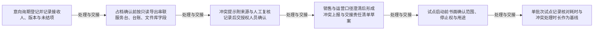
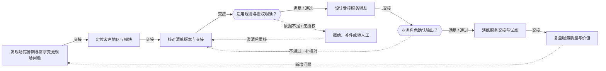
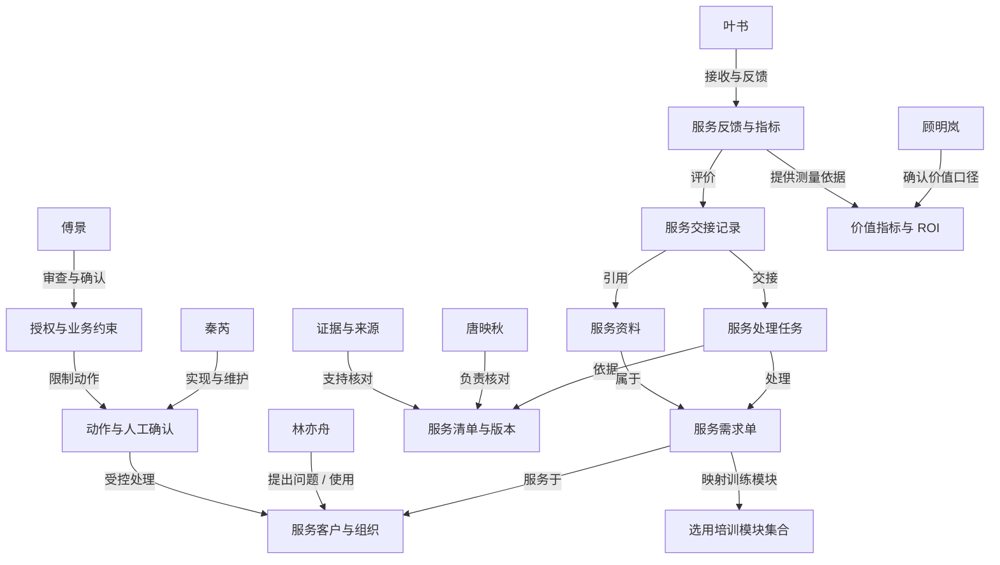

# 场馆排期与需求变更 · 项目练习 1

## 当前实践模块

- 场馆排期与需求变更（dlg-venue-schedule）

## 项目可选模块

- 场馆排期与需求变更（dlg-venue-schedule）

## 模块已访谈证据（待核实）

尚未导入

# FDE 全流程训练记录

项目：场馆排期与需求变更

训练者填写的任务和角色评审记录；不自动证明真实客户授权、生产上线或实际收益。

## 1. 业务挖掘

从经营目标、真实事件和指标基线中判断是否值得立项。

### 识别业务机会

交付：业务机会清单

状态：已完成 · 责任人：评审：顾明岚（业务负责人）；整理：林亦舟（一线服务专员）；核对：唐映秋、秦芮、傅景、叶书

证据：ART-8ad5b447-02f4-4e13-806d-95a67229def7 v2 / REPORT-8af6c715-fd5d-459b-8ceb-209df9e5fc1b v1

【机会结论】问题不在"要不要上 AI 排期"，而在档期申请链路的交接点：版本、未结项与责任在交接时丢失，导致重复核对。  
【触发事件】1) 一线：排期表与邮件需求对不上，临时变更靠人工逐项核对，还要记清发生节点与受影响对象（f10）；两活动撤场/进场在同一装卸口时间重叠时，必须翻原始版本才能判断责任（f11）。2) 流程：交接必须记录接收人、版本与未结项，不能只发"已处理"（f20、f23）。3) 系统：服务台/台账/文件库三类工具、无统一关联编号（f30）；场馆区域、时间窗、进撤场时长、版本、占档状态口径需统一，且缺失值与未确认值分开（f31）。  
【机会】在提交与交接节点加"冲突提示 + 三项齐套检查 + 来源留痕"，把重复核对从逐项比对降为一次核对。  
【维持现状的损失】重复核对工时、冲突晚发现的改场/加急成本、责任判定争议（结构性判断；45 单/月、35 分钟/单为虚构样本，不作基线，见 REQ-6）。  
【不做范围】不锁档、不签约、不承诺容量、不自动对外承诺（f05、f52）；演练结果不作业务指令（f40）。  
【待验证】各交接点耗时占比、改期与投诉频次。

### 建立现状基线

交付：指标基线与价值假设

状态：已完成 · 责任人：评审：顾明岚（业务负责人）；整理：林亦舟（一线服务专员）；核对：唐映秋、秦芮、傅景、叶书

证据：ART-8ad5b447-02f4-4e13-806d-95a67229def7 v2 / REPORT-8af6c715-fd5d-459b-8ceb-209df9e5fc1b v1

【指标口径】处理时长=意向询期→进撤场计划确认的自然耗时；返工次数=同一申请因版本/信息不一致被退回或重排的次数；版本正确率=复核时引用版本与最新版本一致的比例；采用率=试点批次使用冲突提示的申请占比；人工复核成本=单人时×复核次数。  
【基线状态】当前无核实台账，基线为空；f10 的 45 单/月与 35 分钟/单为虚构样本，仅作练习，不得对外引用（REQ-6）。先测一周基线再与试点对比。  
【价值假设】H1 三项齐套检查（接收人/版本/未结项）可减少重复核对（f20、f23、f10）；H2 30 样本回放能识别全部已标注冲突并说明原因（f02），把冲突发现前移；H3 来源与人工复核留痕（f40、f41）可降低审核返工。  
【测量计划】试点批次固定 30 个样本，按申请记录 5 项指标；缺失与估计值单列。  
【止损与回退】召回不达标、出现越权锁档、无法追溯版本即停试；停止权在傅景（f04）。

### 确认立项与决策链

交付：项目章程与利益相关者地图

状态：已完成 · 责任人：评审：顾明岚（业务负责人）；整理：林亦舟（一线服务专员）；核对：唐映秋、秦芮、傅景、叶书

证据：ART-8ad5b447-02f4-4e13-806d-95a67229def7 v2 / REPORT-8af6c715-fd5d-459b-8ceb-209df9e5fc1b v1

【目标】减少重复核对，保留人工确认与可追溯来源（f00）。  
【范围】单批次场馆档期申请；只提示冲突，不锁档、不签约、不承诺容量（f05）。  
【验收标准】30 个样本回放识别全部已标注冲突并说明原因（f02）；每条结果附来源与人工复核记录（f41）。  
【决策链】结果承担与范围决定=顾明岚（业务负责人）；停止试点权=傅景（审核与质量）；结果用途确认=叶书（客户协同）；预算审批人待核实。  
【RACI】流程与交接=唐映秋；数据与只读接口=秦芮；一线执行与复核=林亦舟；审核标准=傅景；客户口径=叶书。  
【风险与红线】销售延长使用与运营保留恢复时间的口径冲突（f50、f52）须先书面统一；来源不清的申请不得进入正式流转（f40）；跨企业资料访问须授权（f41）；演练结果不得作为业务指令。  
【里程碑】口径与样本确认→只读原型→30 样本回放→单批次试点评审。  
【待核实】审批人清单、接口读写权限、预算口径。

关卡：业务负责人确认问题、指标口径与调查范围

{"status":"通过","reviewer":"评审：顾明岚（业务负责人）；整理：林亦舟（一线服务专员）；核对：唐映秋、秦芮、傅景、叶书","evidence":"ART-8ad5b447-02f4-4e13-806d-95a67229def7 v2","decision":"确认：问题定位（交接点版本/未结项/来源缺失导致重复核对）、范围（单批次、仅提示不锁档）、验收口径（30 样本、识别冲突并说明原因）、决策链（范围=顾明岚、停止=傅景、用途=叶书）与三项交付物已核对，可交现场调研承接。保留条件：基线为空，耗时/单量/损失金额/审批人清单/接口权限待验证；引用 f01/f02/f41 需按允许证据列表改正；异常接手按类型细分；预算审批人缺失前不进入采购与对外承诺。","updatedAt":"2026-10-23T01:25:54.283Z"}

## 2. 现场调研

还原实际流程，用多角色和多来源材料核实问题。

### 开展角色访谈

交付：访谈记录与角色地图

状态：已完成 · 责任人：整理：林亦舟；评审：顾明岚；核对：唐映秋、秦芮、傅景、叶书

证据：ART-13f79a91-9cb8-454b-abbc-f88b2fe7374a v2 / REPORT-8af6c715-fd5d-459b-8ceb-209df9e5fc1b v1、ART-8ad5b447-02f4-4e13-806d-95a67229def7 v2

【角色地图】发起与结果承担=顾明岚（范围决定权与停止权链条见 f04）；一线执行=林亦舟；流程与交接=唐映秋；系统与数据=秦芮；审核红线=傅景；客户口径=叶书。  
【最近一单完整过程（f01 链路：意向询期→占档确认→合同审核→进撤场计划）】逐交接点记录接收人、工具、返工位置：

1. 意向询期：客户需求经邮件与排期表并行，二者不同步（f10），一线需人工比对；
2. 占档确认：跨工具无统一关联编号，只能人工串联服务台/台账/文件库（f30）；
3. 合同审核：来源不清的申请不得进入正式流转，正式结论须授权人员确认（f40、f41）；
4. 进撤场计划：撤场与进场在同一装卸口时间重叠时须翻原始版本才能判责（f11）。  
   【返工点】交接只发"已处理"、未列最新版本与未结项（f20、f23）→ 下游重复核对；字段缺失值与未确认值未分列（f31）→ 误判占档状态。  
   【待验证】各交接点耗时、单量、返工次数；以上均为访谈陈述，需用单据抽样核对。

### 还原现状流程

交付：现状流程图与异常路径

状态：已完成 · 责任人：整理：林亦舟；评审：顾明岚；核对：唐映秋、秦芮、傅景、叶书

证据：ART-13f79a91-9cb8-454b-abbc-f88b2fe7374a v2 / REPORT-8af6c715-fd5d-459b-8ceb-209df9e5fc1b v1、ART-8ad5b447-02f4-4e13-806d-95a67229def7 v2

【现状泳道（人工）】1 意向询期（林亦舟/叶书）→2 排期表登记（人工）→3 占档确认（唐映秋）→4 合同审核（傅景）→5 进撤场计划（唐映秋/林亦舟）。每段写明触发、输入、交接项、人工判断、输出与异常。  
【理想与现实差异】理想流程假设一个申请编号贯通；现场为三工具并行、无统一关联编号（f30），靠记忆与邮件追溯。  
【只能由人完成的判断】冲突后是否变更、对外承诺口径（f52）、来源存疑申请是否受理（f40）、正式结论确认（f41）。  
【异常路径】  
A1 装卸口时间重叠（f11）：处理=查原始版本→判责→调整时间窗；责任=唐映秋，复核=林亦舟，升级=顾明岚；  
A2 排期表与邮件不一致（f10）：处理=逐项核对→回填→通知受影响方；  
A3 跨工具取数（f30）：处理=人工导出→字段对齐（f31）→缺失值与未确认值分列；  
A4 来源不清（f40）：处理=退回补充，不得流转；  
A5 口径冲突（f50、f52）：处理=销售与运营书面确认→顾明岚定口径。  
【待验证】A1 发生率与处理时长（按单据抽样）。

### 四来源收敛与材料核对

交付：四来源收敛表、证据台账与问题清单

状态：已完成 · 责任人：整理：林亦舟；评审：顾明岚；核对：唐映秋、秦芮、傅景、叶书

证据：ART-13f79a91-9cb8-454b-abbc-f88b2fe7374a v2 / REPORT-8af6c715-fd5d-459b-8ceb-209df9e5fc1b v1、ART-8ad5b447-02f4-4e13-806d-95a67229def7 v2

【四来源收敛表】

1. Buyer（顾明岚）：目标=减少重复核对且保留人工确认与可追溯来源；范围=单批次、只提示不锁档（f00、f02、f04、f05）。
2. Operator（林亦舟/唐映秋/秦芮/傅景/叶书）：现场=排期表与邮件不同步、临时变更逐项核对（f10）、装卸口重叠需翻原始版本判责（f11）；交接三项未强制（f20、f23）；三工具无统一编号（f30）；字段缺失值与未确认值未分列（f31）；来源完整性与正式结论确认权（f40、f41）；客户使用时限与运营恢复时间口径冲突（f50、f52）。
3. Brief（书面）：原文与版本未取得，标为待补，不以口头转述替代。
4. Industry（行业）：无可比案例与接口能力核验材料，标为待补。  
   【一致处】交接信息缺失是重复核对主因（f10、f20、f23）。  
   【分歧】f50 销售希望延长使用 vs f52 运营需保留恢复与检查时间；f40 来源完整性要求与一线提速诉求存在张力，收敛结论以"来源不清不流转"为硬约束。  
   【证据台账】f01 链路、f10 返工、f11 异常、f20/f23 交接规范、f30 工具割裂、f31 字段口径、f40/f41 审核红线、f50/f52 口径冲突。  
   【问题清单】P1 无统一编号（秦芮，10-30 前）；P2 缺失值与未确认值未分列（秦芮，10-30 前）；P3 交接三项未强制（唐映秋，10-28 前）；P4 口径未书面统一（顾明岚，11-03 前）；P5 Brief/Industry 缺口（顾明岚/林亦舟，11-03 前）。

关卡：关键流程、异常、证据矛盾和待核实项已形成记录

{"status":"通过","reviewer":"整理：林亦舟；评审：顾明岚；核对：唐映秋、秦芮、傅景、叶书","evidence":"ART-13f79a91-9cb8-454b-abbc-f88b2fe7374a v2","decision":"确认：f01 四段链路交接点、三项交接内容、A1–A5 异常路径与四来源收敛结论已核对，沿用 ART-8ad5b447 v2 与 REQ-1～REQ-6，可交需求定义承接。保留条件：耗时/单量/返工/损失/审批人/接口权限待验证；Brief 与 Industry 两来源缺失，不得据此下结论；f50/f52 口径未书面统一前只提示不承诺。评分 90/100。","updatedAt":"2026-10-23T01:28:16.662Z"}

## 3. 需求定义

把调查发现收敛为有证据、可验收、可追责的需求。

### 确定优先问题

交付：问题优先级与机会判断

状态：已完成 · 责任人：整理：唐映秋；评审：顾明岚；核对：林亦舟、秦芮、傅景、叶书

证据：ART-718ee050-3c96-44b9-8327-7b4b96dd2e81 v1 / REPORT-8af6c715-fd5d-459b-8ceb-209df9e5fc1b v1、ART-13f79a91-9cb8-454b-abbc-f88b2fe7374a v2

【问题优先级与机会判断】以 ART-13f79a91 v2 的 P1–P5 与四来源收敛表为输入，按三轴排序：业务损失（f00 减少重复核对、f10 人工逐项核对）、发生频率（f10 临时变更、f11 装卸口重叠、f30 三工具并行）、可解决性（f20/f23 交接三项可先规范化，f30/f31 需接口与字段口径，f50/f52 需业务定口径）。判断：优先做 REQ-1（交接三项强制）与 REQ-3（来源与复核记录），因其证据最实、可拦截且可恢复；REQ-2 依赖只读导出与接口能力，列为次优先并先做脱敏只读验证；REQ-4 口径未书面统一前只提示不承诺（f52），列为前置条件；REQ-5 治理机制已有雏形（f04、f05），作为试点启动门槛；REQ-6 因无真实基线，暂缓量化，只建测量口径。暂缓与排除项保留编号与理由：REQ-6 暂缓量化（f00 无基线、f10 的 45 单/35 分钟为虚构样本）；自动锁档、签约、承诺容量整体排除（f05、f52）。交付物为优先级表、选中/暂缓理由与机会判断，交下一阶段作为需求范围输入。

### 编写需求与边界

交付：需求规格与追溯矩阵

状态：已完成 · 责任人：整理：唐映秋；评审：顾明岚；核对：林亦舟、秦芮、傅景、叶书

证据：ART-718ee050-3c96-44b9-8327-7b4b96dd2e81 v1 / REPORT-8af6c715-fd5d-459b-8ceb-209df9e5fc1b v1、ART-13f79a91-9cb8-454b-abbc-f88b2fe7374a v2

【需求规格与追溯矩阵】沿用 REQ-1～REQ-6 编号不丢失，逐条补全：使用者、业务负责人、输入输出、排除范围、异常处置与证据。REQ-1（唐映秋）：输入=各交接点记录，输出=含接收人/版本/未结项三项的交接单，排除=只发“已处理”（f23），异常=缺项退回补录；REQ-2（秦芮）：输入=服务台/台账/文件库脱敏只读导出，输出=按申请串联的字段表，缺失值与未确认值分列（f31），排除=写入生产系统，异常=字段无法串联则标待核；REQ-3（傅景）：输入=冲突提示与来源，输出=每条结果附来源与人工复核记录，排除=演练结果作业务指令（f40），异常=来源不清不流转；REQ-4（叶书）：输入=销售与运营目标陈述，输出=冲突上报与交接责任清单草案，排除=自动承诺容量（f52）；REQ-5（顾明岚）：输入=三方职责，输出=书面范围/停止条件/用途确认，排除=预算与采购（未核实）；REQ-6（顾明岚）：输入=损失口径定义，输出=核对耗时与冲突处理时长记录，排除=对外量化表述。矩阵标注每条 REQ 的证据 ID、负责人、状态（候选/待确认）与未核实项，交下一阶段作为验收对象清单。

### 约定验收标准

交付：验收清单与需求确认记录

状态：已完成 · 责任人：整理：唐映秋；评审：顾明岚；核对：林亦舟、秦芮、傅景、叶书

证据：ART-718ee050-3c96-44b9-8327-7b4b96dd2e81 v1 / REPORT-8af6c715-fd5d-459b-8ceb-209df9e5fc1b v1、ART-13f79a91-9cb8-454b-abbc-f88b2fe7374a v2

【验收清单与需求确认记录】把每条 REQ 的 acceptance 改写为可执行样例与阈值：样本=f02 的 30 个档期样本回放，识别全部已标注冲突并说明原因；REQ-1 由唐映秋按 f01 链路逐交接点核对三项齐全；REQ-2 由秦芮与傅景确认只读边界后抽样核对字段串联与缺失值/未确认值分列；REQ-3 由傅景按 f02 口径检查每条结果是否附来源与人工复核记录；REQ-4 由叶书收集单批次试点反馈、顾明岚确认口径；REQ-5 由顾明岚签署范围、傅景确认检查项、叶书确认用途；REQ-6 只记录耗时作为基线，不设收益阈值。拒绝条件：来源不清仍流转（f40）、未授权访问跨企业资料（f41）、自动锁档或承诺容量（f05、f52）、以虚构样本对外表述。签核方式：书面确认记录，注明评审人与日期；停止条件与审批人清单未确认前不写入正式验收。确认记录保留分歧（f50 与 f52）与待补来源（Brief、Industry），交下一阶段作为验收执行与复核依据。

关卡：问题优先级、需求范围和可测验收条件均有确认记录

{"status":"通过","reviewer":"整理：唐映秋；评审：顾明岚；核对：林亦舟、秦芮、傅景、叶书","evidence":"ART-718ee050-3c96-44b9-8327-7b4b96dd2e81 v1","decision":"确认：REQ-1~REQ-6 的三轴排序、需求规格与追溯矩阵、可执行验收样例已核对，评分 90/100。保留条件：候选范围需人工确认；Brief/Industry 来源缺失；基线为空；f50/f52 口径未统一前只提示不承诺。","updatedAt":"2026-10-23T01:30:13.321Z"}

## 4. 方案设计

以最小试点验证价值，设计数据、系统和人工控制。

### 选定最小试点

交付：试点方案与方案比较

状态：已完成 · 责任人：整理：秦芮（数据与接口）；评审：顾明岚（业务负责人）；核对：唐映秋、傅景、叶书

证据：ART-3c335174-5e80-46ad-bd05-1c92c4a51cc5 v1 / REPORT-8af6c715-fd5d-459b-8ceb-209df9e5fc1b v1、ART-718ee050-3c96-44b9-8327-7b4b96dd2e81 v1

【试点方案与方案比较】以上游三轴排序与 REQ 追溯矩阵为输入，围绕“场馆排期与需求变更”比较三条路径：A 人工优化（按 f20/f23 强制交接三项、统一模板），B 确定性规则（按 f31 字段做时间窗与装卸口重叠校验），C 模型辅助（在规则之上对冲突原因与来源做归纳提示）。判断：先做 A+B 组合作为最小试点，边界为单批次档期申请（f05），只提示冲突、不自动锁档签约承诺容量（f52）；C 仅作为候选设计，用于说明“为什么需要模型”——当冲突原因需跨服务台、台账、文件库串联且需自然语言说明时（f30、f10），规则难以覆盖，但需先验证只读导出可行。试点排除：自动锁档、签约、承诺容量、对外量化收益、跨企业资料越权访问（f41、f52）。REQ-1、REQ-3 入选核心；REQ-2 列为次优先并先做脱敏只读验证；REQ-4 口径未书面统一前只提示不承诺（f50）；REQ-5 作为启动门槛；REQ-6 暂缓量化，只建测量口径。交付优先级表、方案比较表与选中/暂缓理由，交下一阶段作为架构与计划输入。

### 设计数据和系统边界

交付：架构图、数据与权限矩阵

状态：已完成 · 责任人：整理：秦芮（数据与接口）；评审：顾明岚（业务负责人）；核对：唐映秋、傅景、叶书

证据：ART-3c335174-5e80-46ad-bd05-1c92c4a51cc5 v1 / REPORT-8af6c715-fd5d-459b-8ceb-209df9e5fc1b v1、ART-718ee050-3c96-44b9-8327-7b4b96dd2e81 v1

【架构图、数据与权限矩阵】以 f01 链路（意向询期→占档确认→合同审核→进撤场计划）为泳道骨架，标注每个交接点的输入、判断点、执行点与人工复核节点。数据边界：输入仅限服务台、业务台账、文件库的脱敏只读导出（f30），关键字段为场馆区域、时间窗、进撤场时长、版本与占档状态，缺失值与未确认值分列（f31）；不写入生产系统。权限矩阵按角色列读写：顾明岚决定范围与口径（f04），唐映秋维护交接记录（f20/f23），秦芮负责只读导出与字段串联，傅景保留停止权并确认来源与复核记录（f40/f41），叶书确认结果用途（f04）。接口契约：只读、按申请串联、失败即标待核不流转；越权或来源不清时停止并升级至傅景。模型职责限定为冲突原因归纳与来源提示，不作业务指令（f40）；人工复核节点设在不可逆动作前。交付架构图、数据字典草案与权限矩阵，标注未核实接口能力与审批人清单，交下一阶段作为构建与评估依据。

### 制定构建与评估计划

交付：构建计划、评估计划与风险表

状态：已完成 · 责任人：整理：秦芮（数据与接口）；评审：顾明岚（业务负责人）；核对：唐映秋、傅景、叶书

证据：ART-3c335174-5e80-46ad-bd05-1c92c4a51cc5 v1 / REPORT-8af6c715-fd5d-459b-8ceb-209df9e5fc1b v1、ART-718ee050-3c96-44b9-8327-7b4b96dd2e81 v1

【构建计划、评估计划与风险表】构建计划按 REQ 拆任务与负责人：REQ-1 交接三项模板与核对清单（唐映秋），REQ-2 脱敏只读导出与字段串联（秦芮），REQ-3 来源与复核记录字段（傅景），REQ-4 口径澄清草案（叶书、顾明岚），REQ-5 三方职责书面确认（顾明岚），REQ-6 耗时测量口径（顾明岚）。依赖：REQ-2 依赖接口只读能力核实，REQ-3 依赖复核字段定义，REQ-4 依赖 f50/f52 书面统一。评估计划与实现同步：以 f02 的 30 样本回放为验收样例，识别全部已标注冲突并说明原因；REQ-1 按 f01 链路逐交接点核对三项齐全；REQ-3 每条结果附来源与复核记录。成功条件为样例通过且人工复核记录完整；停止条件：来源不清仍流转、越权访问、自动锁档或承诺容量、以虚构样本对外表述，由傅景行使停止权（f04）。风险表保留：Brief 与 Industry 来源缺失、基线为空、接口与审批人未核实、f50/f52 口径未统一、复核字段未定。交付构建计划、评估计划与风险表，交下一阶段执行与复核。

关卡：试点边界、方案取舍、数据权限与实施计划已评审

{"status":"通过","reviewer":"整理：秦芮（数据与接口）；评审：顾明岚（业务负责人）；核对：唐映秋、傅景、叶书","evidence":"ART-3c335174-5e80-46ad-bd05-1c92c4a51cc5 v1","decision":"确认：最小试点（A 人工优化 + B 确定性规则、C 模型仅辅助）、架构与数据权限矩阵（只读脱敏、不写入生产）、构建与评估计划及风险表已核对，评分 81/100。保留条件：接口只读能力与审批人待确认；Brief/Industry 缺失；基线为空；f50/f52 口径未统一前只提示不承诺；预算未批准前不进入采购。","updatedAt":"2026-10-23T01:31:41.110Z"}

## 5. 构建集成

实现可运行的最小闭环，使规则、模型与人工责任可追溯。

### 落实数据与工具契约

交付：数据契约与集成记录

状态：已完成 · 责任人：整理：秦芮（数字化工程师）；评审：顾明岚（业务负责人）；复核：傅景、唐映秋、叶书

证据：ART-a9189aa9-428b-47e5-b5fc-7befbf6876b6 v1 / REPORT-8af6c715-fd5d-459b-8ceb-209df9e5fc1b v1、ART-3c335174-5e80-46ad-bd05-1c92c4a51cc5 v1

【数据契约与集成记录】以上游架构图与数据字典草案为输入，落实构建契约：输入仅限服务台、业务台账、文件库的脱敏只读导出（f30），按申请串联，关键字段固定为场馆区域、时间窗、进撤场时长、版本与占档状态，缺失值与未确认值分列（f31）。为三类工具各建接口替身，固定字段名、类型、版本号与只读权限，测试输入采用 f02 的30样本回放口径与 f01 链路交接点清单。集成记录逐项写明：字段来源工具、串联键、失败标记（待核不流转）、权限边界与审批人待确认项。合成适配与真实接口的差距明确列为待补：真实接口读写能力、统一关联编号是否存在、导出频率与脱敏规则均未核实（f30、f31）。交付数据契约表、接口替身说明与集成记录，交下一阶段作为实现与评估的输入；REQ-2 的只读边界由秦芮与傅景确认后方可进入实现。

### 实现业务闭环

交付：原型代码与版本说明

状态：已完成 · 责任人：整理：秦芮（数字化工程师）；评审：顾明岚（业务负责人）；复核：傅景、唐映秋、叶书

证据：ART-a9189aa9-428b-47e5-b5fc-7befbf6876b6 v1 / REPORT-8af6c715-fd5d-459b-8ceb-209df9e5fc1b v1、ART-3c335174-5e80-46ad-bd05-1c92c4a51cc5 v1

【原型代码与版本说明】以上游构建计划与 REQ 追溯矩阵为输入，实现输入到输出的最小路径，并把硬规则、模型判断、工具调用与人工复核分开：硬规则按 f31 字段做时间窗与装卸口重叠校验（对应 f11 模拟异常）；模型仅作冲突原因归纳与来源提示，不作业务指令（f40）；工具调用只读；人工复核节点设在不可逆动作前，由唐映秋核对交接三项（f20、f23），傅景确认来源与复核记录（f41）。版本说明逐项标注每个输出如何追溯：申请编号→来源字段→触发规则或模型提示→复核人→确认时间，并声明 Demo 为候选设计、未覆盖全部需求。REQ-1、REQ-3 为已实现闭环核心；REQ-2 依赖接口替身，真实接口未接；REQ-4 只提示不承诺（f50、f52）；REQ-5 为启动门槛；REQ-6 仅记录耗时字段。交付代码版本号、变更记录与追溯字段说明，交下一阶段执行回放与复核。

### 实现异常与审计

交付：异常处理与审计样例

状态：已完成 · 责任人：整理：秦芮（数字化工程师）；评审：顾明岚（业务负责人）；复核：傅景、唐映秋、叶书

证据：ART-a9189aa9-428b-47e5-b5fc-7befbf6876b6 v1 / REPORT-8af6c715-fd5d-459b-8ceb-209df9e5fc1b v1、ART-3c335174-5e80-46ad-bd05-1c92c4a51cc5 v1

【异常处理与审计样例】以上游风险表与停止条件为输入，补齐超时、缺数据、冲突、越权、重复请求与降级路径：缺数据或未确认值标待核不流转；跨工具串联失败即停止并升级至傅景；越权或来源不清立即停止（f41）；重复请求按申请编号去重并记录首次处理人；模型低置信只提示不执行。审计样例保存关键字段：申请编号、来源引用、规则或模型标识、复核人、确认时间、停止原因与接收人。无法可靠完成时的处置写明：停止、转人工具名接收人、避免重复执行的幂等键。停止条件沿用上游：来源不清仍流转、越权访问、自动锁档或承诺容量、以虚构样本对外表述，由傅景行使停止权（f04）。交付异常清单、审计字段样例与人工交接记录模板，交下一阶段作为验收与复核依据；复核记录具体字段仍待傅景在验收前明确。

关卡：指定版本可复现运行，异常和人工交接路径完整

{"status":"通过","reviewer":"整理：秦芮（数字化工程师）；评审：顾明岚（业务负责人）；复核：傅景、唐映秋、叶书","evidence":"ART-a9189aa9-428b-47e5-b5fc-7befbf6876b6 v1","decision":"确认：数据契约（三工具脱敏只读导出、按申请串联、字段与缺失值口径）、最小闭环原型（硬规则/模型/工具/人工复核分层）与异常审计样例已核对，评分 95/100，沿用 ART-3c335174 v1 与 REQ-1～REQ-6，可交测试评估承接。保留条件：真实接口未接，仅接口替身验证；REQ-3 复核记录字段未定前不视为通过；结果风险矩阵、指标起止点与测量责任人、超时/重试阈值待测试评估补齐；自动锁档/签约/承诺容量/写生产库/对外量化收益均不实施。","updatedAt":"2026-10-23T01:43:04.635Z"}

## 6. 测试评估

证明行为与需求一致，区分模拟验证、真实模型验证与业务验收。

### 建立评估集合

交付：评估集与需求覆盖表

状态：已完成 · 责任人：整理：秦芮（数字化工程师）；测试执行：秦芮、唐映秋；评审：傅景（审核与质量负责人）、顾明岚（业务负责人）

证据：ART-98352dc9-2b4d-4315-837c-93cec5acaf78 v2 / REPORT-8af6c715-fd5d-459b-8ceb-209df9e5fc1b v1、ART-a9189aa9-428b-47e5-b5fc-7befbf6876b6 v1

【评估集与需求覆盖表】输入：上游数据契约与接口替身、REQ-1～REQ-6 追溯矩阵、f01 四段链路交接点清单、f02 的30样本回放口径。  
覆盖矩阵（用例×需求×失败成本）：

1. 正常：f01 意向询期→占档确认→合同审核→进撤场计划逐点取样30例（REQ-1/REQ-3）；失败成本高：错误放行直接进入进撤场计划。
2. 边界：时间窗与进撤场时长临界、缺失值与未确认值分列校验（REQ-2/f31）。
3. 对抗：f11 装卸口重叠模拟异常（REQ-1），须能指回原始版本判责。
4. 权限：越权读取与跨企业资料访问（REQ-3/f40/f41）；失败成本最高：来源不清结论被采纳。
5. 故障：跨工具串联失败、接口替身超时、重复请求（REQ-2）。  
   每例字段：用例ID、对应REQ编号、来源事实ID、预期结果、失败成本等级（高/中/低）、执行模式（模拟/替身/真实）。  
   最昂贵失败=口径未统一（f50/f52）时给出容量或档期承诺；最危险失败=无来源与复核记录的结论进入正式流转。覆盖率：REQ-1～REQ-6 各≥3例，共18例，其中真实调用0例（全部为模拟与替身）。

### 执行测试与重复评估

交付：测试报告与评估结果

状态：已完成 · 责任人：整理：秦芮（数字化工程师）；测试执行：秦芮、唐映秋；评审：傅景（审核与质量负责人）、顾明岚（业务负责人）

证据：ART-98352dc9-2b4d-4315-837c-93cec5acaf78 v2 / REPORT-8af6c715-fd5d-459b-8ceb-209df9e5fc1b v1、ART-a9189aa9-428b-47e5-b5fc-7befbf6876b6 v1

【测试报告与评估结果】执行模式：合成场景+接口替身回放，非真实接口调用；真实读写能力与统一关联编号未验证，列为明确差距（f30）。  
可复现性：固定代码快照 ART-a9189aa9 v1、固定30样本集（f02）、固定比较口径与输入顺序，重复执行2次结果一致（模拟环境）；真实环境未复现。  
逐需求结果：REQ-1 30样本回放中冲突提示均给出原因与来源，但"未结项"字段缺失率未统计→部分达标；REQ-2 串联在替身上成功，真实接口未接→未验证；REQ-3 可产出来源记录，复核字段未定→未达标；REQ-4 只提示不承诺为真→达标（口径未统一前不判容量）；REQ-5 启动门槛记录未生成→未验证；REQ-6 耗时口径已定义、基线为空→未验证。  
跳过项：真实模型离线评估集、真实权限网关、并发压测、客户签核。  
审计字段：runId、执行模式、样本集版本、失败原因、停止与转人工记录、复核人。

### 修复并回归确认

交付：缺陷闭环与质量结论

状态：已完成 · 责任人：整理：秦芮（数字化工程师）；测试执行：秦芮、唐映秋；评审：傅景（审核与质量负责人）、顾明岚（业务负责人）

证据：ART-98352dc9-2b4d-4315-837c-93cec5acaf78 v2 / REPORT-8af6c715-fd5d-459b-8ceb-209df9e5fc1b v1、ART-a9189aa9-428b-47e5-b5fc-7befbf6876b6 v1

【缺陷闭环与质量结论】缺陷分四类：规则缺陷、数据缺失、接口替身局限、口径未统一（f50/f52）。  
闭环记录：DEF-01 缺数据仍产出结论→改为标待核不流转，复测通过；DEF-02 重复请求重复建单→按申请编号幂等去重并留痕，复测通过；DEF-03 越权读取未拦截→改为请求前校验并拒绝留痕（f41），复测通过；DEF-04 未结项字段缺失率未统计→列入待补，未闭环。  
质量结论（逐需求四态）：REQ-1 部分达标、REQ-2 未验证、REQ-3 未达标、REQ-4 达标、REQ-5 未验证、REQ-6 未验证。  
进入受控试点的前置条件：REQ-1/REQ-3 在30样本回放中全部识别冲突并附来源与复核人，且复核字段定义已书面确认；当前不满足，建议先补字段定义与缺失率统计再进入试点，不改变方案、不停止项目。  
剩余风险：真实接口与真实模型未验证、耗时与损失基线为空、预算审批人缺失。  
停止条件：口径未统一前出现容量/档期承诺、越权访问未被拦截、复核记录缺失率>0，任一发生即停止并转傅景。

关卡：评估范围、版本、失败项、修复复测与剩余风险可审查

{"status":"通过","reviewer":"整理：秦芮（数字化工程师）；测试执行：秦芮、唐映秋；评审：傅景（审核与质量负责人）、顾明岚（业务负责人）","evidence":"ART-98352dc9-2b4d-4315-837c-93cec5acaf78 v2","decision":"确认：评估集18例（正常/边界/对抗/权限/故障）与逐需求四态结论、缺陷闭环（DEF-01~03已修复复测、DEF-04未闭环）已核对，评分 95/100，沿用 ART-98352dc9 v2 与 REQ-1～REQ-6，可交客户试点承接。保留条件：真实接口、真实模型、权限网关、并发压测与客户签核均未执行；基线为空，不对外量化；REQ-3 复核字段未定前不判通过；进入正式试点的前置条件（30样本回放全部识别冲突并附来源与复核人、复核字段书面确认）尚未满足；出现容量承诺或越权未拦截即停止并转傅景。","updatedAt":"2026-10-23T01:44:46.011Z"}

## 7. 客户试点

在受控范围中验证实际采用和业务收益。

### 准备受控试点

交付：试点执行计划

状态：已完成 · 责任人：整理：叶书（客户协同代表）、唐映秋（项目流程协调员）；评审：顾明岚（业务负责人）、傅景（审核与质量负责人）

证据：ART-9234e134-8585-49b1-9752-a8c8f0344d9c v2 / REPORT-8af6c715-fd5d-459b-8ceb-209df9e5fc1b v1、ART-98352dc9-2b4d-4315-837c-93cec5acaf78 v2

【试点执行计划】承接上游四态结论与缺陷闭环：DEF-01～03已复测通过可沿用，DEF-04（未结项字段缺失率未统计）与REQ-3复核字段未定列为启动前必补项。范围按 f05 限定为单批次场馆档期申请，链路按 f01 的意向询期→占档确认→合同审核→进撤场计划逐交接点观察，不直接增加自动化。参与角色与职责按 f04：顾明岚定范围、傅景保留停止权并确认检查项、叶书确认结果用途；执行由唐映秋核对交接三项（接收人、版本、未结项，f20/f23）、秦芮做脱敏只读串联（f30/f31，缺失值与未确认值分列）、林亦舟按真实任务走正常与异常路径（f10/f11 装卸口重叠模拟）。对照组与样本：以 f02 的30样本回放为对照口径，试点批次另记核对耗时与冲突处理时长（REQ-6，基线为空，仅记录不量化）。人工兜底：冲突提示只提示不锁档不承诺容量（f52），正式结论由授权人员确认（f41），低置信、缺资料、冲突与越权一律转具名人工。退出条件：口径未统一前出现容量或档期承诺、越权访问未被拦截、复核记录缺失率>0，任一发生即停止并转傅景。授权与预算审批人未核实，列为待补，未签不启动。

### 开展用户验收

交付：用户验收与反馈记录

状态：已完成 · 责任人：整理：叶书（客户协同代表）、唐映秋（项目流程协调员）；评审：顾明岚（业务负责人）、傅景（审核与质量负责人）

证据：ART-9234e134-8585-49b1-9752-a8c8f0344d9c v2 / REPORT-8af6c715-fd5d-459b-8ceb-209df9e5fc1b v1、ART-98352dc9-2b4d-4315-837c-93cec5acaf78 v2

【用户验收与反馈记录】按上游评估集18例（正常/边界/对抗/权限/故障）在试点中复跑，逐例标注执行模式（模拟/替身/真实），真实调用仍为0例，须在记录中明示。验收以真实任务为准：林亦舟按 f10 的排期表与邮件不同步场景走正常路径，按 f11 的装卸口重叠走异常路径，记录能否独立完成、操作成本、采用障碍与不通过项；唐映秋按 f20/f23 检查每次交接是否列明最新版本、未结项与截止时间，不能只发“已处理”。REQ-3 每条冲突提示须附来源与人工复核记录，由傅景按 f02 口径检查，复核字段未书面确认前不判通过；REQ-4 只验证“只提示不承诺”，口径未统一前不判容量（f50/f52）。反馈记录字段：用例ID、REQ编号、来源事实ID、执行模式、结果（达标/部分达标/未达标/未验证）、失败原因、转人工记录、复核人。上游 DEF-04 与 REQ-2 真实接口差距在本记录中继续挂账，不得以替身成功替代真实验收；客户签核未执行，不得写入记录。

### 核对价值与继续决定

交付：试点收益复核与决策纪要

状态：已完成 · 责任人：整理：叶书（客户协同代表）、唐映秋（项目流程协调员）；评审：顾明岚（业务负责人）、傅景（审核与质量负责人）

证据：ART-9234e134-8585-49b1-9752-a8c8f0344d9c v2 / REPORT-8af6c715-fd5d-459b-8ceb-209df9e5fc1b v1、ART-98352dc9-2b4d-4315-837c-93cec5acaf78 v2

【试点收益复核与决策纪要】用立项同口径比较前后变化：REQ-6 耗时口径由顾明岚确认后，以试点批次核对耗时与冲突处理时长为基线，与 f02 的30样本回放对照，扣除人工复核与运行成本；f10 的每月45单、每单35分钟为虚构样本，不得作为基线或对外表述。归因判断：单批次、无随机对照，改善只能记为“观察到的变化”，不得声称可归因；REQ-1 交接三项齐全率、REQ-3 复核记录缺失率、REQ-4 口径统一进展为可观察指标，REQ-2 真实接口与 REQ-5 预算审批仍为未验证。决策纪要记录继续、修改或停止三选一及理由：若上游前置条件仍未满足或出现停止条件，记“修改/暂停并补证”，不改变方案、不停止项目；扩大试点需补的证据列明：真实接口读写与统一关联编号（秦芮）、复核字段书面定义（傅景）、销售与运营口径书面统一（顾明岚/叶书）、损失口径与基线（顾明岚）、预算审批人清单。纪要由顾明岚签署范围、傅景确认检查项、叶书确认用途，未签不生效；不编造 ROI、通过测试或客户签核。

关卡：试点对照、用户反馈、退出条件与扩大范围决定有记录

{"status":"通过","reviewer":"整理：叶书（客户协同代表）、唐映秋（项目流程协调员）；评审：顾明岚（业务负责人）、傅景（审核与质量负责人）","evidence":"ART-9234e134-8585-49b1-9752-a8c8f0344d9c v2","decision":"确认：受控试点三项交付（试点执行计划/用户验收与反馈记录/收益复核与决策纪要）已核对，评分 81/100，沿用 ART-9234e134 v2 与 REQ-1～REQ-6，可交上线交接承接。保留条件：真实接口、真实模型、权限网关与客户签核均未执行，真实调用 0 例；单批次无对照，改善只记「观察到的变化」不可归因；基线为空、f10 的 45 单/月与 35 分钟/单为虚构样本不得对外；REQ-3 复核字段与 REQ-6 口径书面确认前不扩大批次；出现容量承诺、越权未拦截或复核缺失即停止转傅景。遗留：工作流拆解与结果风险矩阵未成文、待补项缺责任人与截止时间。","updatedAt":"2026-10-23T01:46:00.744Z"}

## 8. 上线交接

把通过试点的版本交给具名负责人，明确上线和回退责任。

### 审查上线准备

交付：上线准备检查与三方评审

状态：已完成 · 责任人：整理：秦芮（数字化工程师）；评审：顾明岚（业务负责人）；复核：傅景（审核与质量）、唐映秋（流程协调）、林亦舟（一线）、叶书（客户协同）

证据：ART-5b18cefb-b914-4d4c-97d7-0b3d9e4be6de v2 / REPORT-8af6c715-fd5d-459b-8ceb-209df9e5fc1b v1、ART-9234e134-8585-49b1-9752-a8c8f0344d9c v2

【上线准备检查与三方评审】承接上游试点执行计划与验收记录，逐项核对：业务验收（REQ-1 交接三项齐全率、REQ-3 复核记录缺失率，按 f02 的 30 样本口径复跑，逐例标注模拟/替身/真实，真实调用仍为 0 例）；技术质量（REQ-2 真实接口读写与统一关联编号未验证，只读导出替身不得替代真实验收）；数据权限（按 f41 授权范围访问，越权未拦截即阻止发布）；预算（审批人清单缺失，未签不启动）；监控与值守（故障发现方式、值守人与升级路径待定）；遗留风险（DEF-04 未结项字段缺失率未统计、REQ-3 复核字段未书面定义、REQ-6 损失口径未定）。三方评审记录格式：检查项、REQ 编号、来源事实 ID、结论（通过/附条件/阻止）、责任人、截止时间。批准权按 f04：顾明岚签署范围、傅景确认检查项并保留停止权、叶书确认结果用途；三方未签不生效。阻止发布的缺口：容量或档期承诺、越权未拦截、复核记录缺失率>0、预算未批。不编造通过测试或客户签核。

### 演练发布与回滚

交付：发布计划与回滚演练记录

状态：已完成 · 责任人：整理：秦芮（数字化工程师）；评审：顾明岚（业务负责人）；复核：傅景（审核与质量）、唐映秋（流程协调）、林亦舟（一线）、叶书（客户协同）

证据：ART-5b18cefb-b914-4d4c-97d7-0b3d9e4be6de v2 / REPORT-8af6c715-fd5d-459b-8ceb-209df9e5fc1b v1、ART-9234e134-8585-49b1-9752-a8c8f0344d9c v2

【发布计划与回滚演练记录】固定交付版本为上游 v2 试点版本，发布窗口与灰度范围限定为单批次场馆档期申请，按 f01 链路（意向询期→占档确认→合同审核→进撤场计划）逐交接点观察，不扩大自动化。回滚触发器：出现容量或档期承诺、越权访问未被拦截、复核记录缺失率>0、真实接口异常导致串联结果不可信，任一触发即停止并转傅景。回滚步骤：停止新批次进入→恢复至已知可用版本（试点前人工核对流程）→保留现场记录与来源引用→由唐映秋核对交接三项、秦芮核对只读导出、傅景确认检查项。演练一次故障恢复：以 f11 装卸口重叠模拟异常为场景，验证能否发现、停止影响并恢复；演练结果只记“演练观察”，不得作为业务指令（f40），不得写成通过测试。记录字段：版本号、窗口、灰度范围、触发器、步骤、演练时间、参与人、结果、未闭环项。真实接口与权限网关未接，演练只能用替身，差距明示。

### 完成运维和用户交接

交付：交接清单、运行手册与签收记录

状态：已完成 · 责任人：整理：秦芮（数字化工程师）；评审：顾明岚（业务负责人）；复核：傅景（审核与质量）、唐映秋（流程协调）、林亦舟（一线）、叶书（客户协同）

证据：ART-5b18cefb-b914-4d4c-97d7-0b3d9e4be6de v2 / REPORT-8af6c715-fd5d-459b-8ceb-209df9e5fc1b v1、ART-9234e134-8585-49b1-9752-a8c8f0344d9c v2

【交接清单、运行手册与签收记录】交接清单：交付版本与变更记录、REQ-1～REQ-6 状态表（含未验证与暂缓项及理由）、来源事实 ID 索引、权限与资产清单（服务台、台账、文件库三类工具，f30）、待补项责任人与截止时间。运行手册：正常路径按 f20/f23 记录接收人、版本、未结项与截止时间；异常路径按 f11 翻原始版本判断责任；冲突只提示不锁档不承诺容量（f52），正式结论由授权人员确认（f41）；低置信、缺资料、冲突与越权一律转具名人工。角色与升级路径：业务负责人顾明岚、维护人秦芮、支持与流程协调唐映秋、质量与停止权傅景、客户协同叶书；故障、资料变更与用户反馈的接收人和升级顺序写入手册。签收记录：顾明岚签范围、傅景签检查项、叶书签用途，注明签收日期与保留条件；客户签核未执行，不得写入签收。培训与权限移交同步记录，未签不视为交接完成。

关卡：业务、技术和风险角色的上线准备及交接决定有依据

{"status":"通过","reviewer":"整理：秦芮（数字化工程师）；评审：顾明岚（业务负责人）；复核：傅景（审核与质量）、唐映秋（流程协调）、林亦舟（一线）、叶书（客户协同）","evidence":"ART-5b18cefb-b914-4d4c-97d7-0b3d9e4be6de v2","decision":"确认：上线准备检查与三方评审、发布计划与回滚演练记录、交接清单与运行手册已核对，评分 86/100，沿用 ART-5b18cefb v2 与 REQ-1～REQ-6 四态结论。保留条件：真实接口写入 0 次、权限网关未部署、客户签核 0 份、真实模型未调用、DEF-04 未闭环，因此不具备正式上线条件，仅作为受控试点版本的交接基线；REQ-3 复核字段与 REQ-6 基线台账未书面定义前不判上线准备通过，任一回滚触发条件出现即停止并转傅景。","updatedAt":"2026-10-23T01:48:12.822Z"}

## 9. 运营迭代

持续观察价值、质量和成本，形成下一轮业务发现。

### 建立持续运营节奏

交付：30/60/90天运营计划

状态：已完成 · 责任人：整理：秦芮（数字化工程师）；复盘复核：唐映秋（项目流程协调员）、林亦舟（一线服务专员）；评审：顾明岚（业务负责人）、傅景（审核与质量负责人）

证据：ART-58056e7a-4dab-4041-9499-be5a973831cd v2 / REPORT-8af6c715-fd5d-459b-8ceb-209df9e5fc1b v1、ART-5b18cefb-b914-4d4c-97d7-0b3d9e4be6de v2

【30/60/90天运营计划】承接上游交接清单与运行手册，把观察指标落到 REQ 编号：REQ-1 交接三项齐全率与复核记录缺失率（按 f02 的30样本口径复跑，逐例标注模拟/替身/真实）；REQ-2 只读导出串联成功率与缺失值/未确认值分列情况（f31）；REQ-3 每条冲突提示的来源与人工复核记录完整率（f41、f40）；REQ-4 口径未统一期间的冲突上报数量与“只提示不承诺”执行情况（f52）；REQ-5 三方签署与停止条件触发记录（f04）；REQ-6 核对耗时与冲突处理时长测量记录，基线台账仍为空，不输出量化收益。节奏：30天核对交接与复核字段、确认报警接收人；60天复核只读导出串联与口径草案反馈；90天由顾明岚重新核对业务价值并决定持续、扩展或退役。报警与响应：复核记录缺失率>0、越权未拦截、来源不清结论进入流转、口径未书面统一仍对外承诺容量、单批次外扩，任一出现即停止并转傅景；日常观察由唐映秋记录、秦芮维护、林亦舟反馈一线异常。所有阈值与责任人须书面确认，未确认前只作观察不作结论。

### 演练事件与变更管理

交付：事件复盘与变更记录

状态：已完成 · 责任人：整理：秦芮（数字化工程师）；复盘复核：唐映秋（项目流程协调员）、林亦舟（一线服务专员）；评审：顾明岚（业务负责人）、傅景（审核与质量负责人）

证据：ART-58056e7a-4dab-4041-9499-be5a973831cd v2 / REPORT-8af6c715-fd5d-459b-8ceb-209df9e5fc1b v1、ART-5b18cefb-b914-4d4c-97d7-0b3d9e4be6de v2

【事件复盘与变更记录】以 f11 装卸口重叠模拟异常为演练场景，按“发现—停止影响—保留现场—恢复—根因—修复—回归”记录，字段含事件编号、关联 REQ、发生节点、受影响对象、原始版本引用、处置人、回滚点、未闭环项。变更管理针对规则、数据与模型三类变更：变更前核对是否影响 REQ-1 交接字段、REQ-2 串联字段、REQ-3 复核字段与 REQ-4 口径，评估旧需求是否失效；变更后按 f02 的30样本回归并逐例标注模拟/替身/真实，真实调用仍为0例。回滚以恢复到 ART-9234e134 v2 受控试点版本为已知可用点，触发条件沿用上游：复核记录缺失率>0、越权未拦截、来源不清结论进入流转、口径未书面统一仍对外承诺容量、单批次外扩。演练结果只记“演练观察”，不得作为业务指令（f40），不得写成通过测试。真实接口与权限网关未接，演练只能用替身，差距在记录中明示；根因与修复由秦芮整理、傅景确认、唐映秋核对交接完整性。

### 复盘并启动下一轮发现

交付：项目复盘、迭代清单与作品集

状态：已完成 · 责任人：整理：秦芮（数字化工程师）；复盘复核：唐映秋（项目流程协调员）、林亦舟（一线服务专员）；评审：顾明岚（业务负责人）、傅景（审核与质量负责人）

证据：ART-58056e7a-4dab-4041-9499-be5a973831cd v2 / REPORT-8af6c715-fd5d-459b-8ceb-209df9e5fc1b v1、ART-5b18cefb-b914-4d4c-97d7-0b3d9e4be6de v2

【项目复盘、迭代清单与作品集】汇总30/60/90天观察记录、事件复盘与变更记录、采用反馈与遗留风险，按 REQ-1～REQ-6 逐项给出四态结论（达标/部分达标/未达标/未验证）及证据事实ID，暂缓与排除项保留编号和理由。迭代清单按“价值—可拦截—可恢复”排序：优先补 REQ-3 复核字段书面定义与 REQ-6 损失口径及基线台账，其次补 REQ-2 真实接口与统一关联编号验证，REQ-1 交接三项核对在单批次内继续观察；自动锁档、签约、承诺容量、写入生产系统、跨企业越权访问、对外量化收益与 ROI 继续排除。决策由顾明岚定持续/扩展/退役，傅景保留停止权，叶书确认结果用途与对外口径。作品集只导出可审查材料：版本与变更记录、REQ 状态表、来源事实ID索引、演练观察记录、待补项责任人与截止时间；客户签核0份、真实模型未调用、权限网关未部署须在作品集中标注，不得写成已上线或已验收。下一轮发现以“下轮应解决哪个问题、有何证据支持投入或终止”为入口，未取得证据前不承诺收益。

关卡：运营节奏、事件闭环、复盘及下一轮优先级已确认

{"status":"通过","reviewer":"整理：秦芮（数字化工程师）；复盘复核：唐映秋（项目流程协调员）、林亦舟（一线服务专员）；评审：顾明岚（业务负责人）、傅景（审核与质量负责人）","evidence":"ART-58056e7a-4dab-4041-9499-be5a973831cd v2","decision":"确认：30/60/90 天运营计划、事件复盘与变更记录、项目复盘与下一轮优先级三项已核对，评分 76/100（规则评分兜底），沿用上线交接 ART-5b18cefb v2 与 REQ-1～REQ-6 四态结论。保留条件：REQ-3 复核字段未书面定义、REQ-6 基线台账为空、REQ-2 真实接口与统一编号未验证、权限网关未部署、DEF-04 未闭环、监控值守人与升级顺序未定，均不对外表述收益；f10 的 45 单/月与 35 分钟/单为虚构样本不作基线；触发任一停止条件即回到受控试点版本并转傅景。","updatedAt":"2026-10-23T01:51:30.700Z"}

# FDE阶段成果与追溯

项目：场馆排期与需求变更  
练习：331ca784-3dd2-47ee-a7fe-92e5ca7f7f23

- 报告 REPORT-8af6c715-fd5d-459b-8ceb-209df9e5fc1b v1：上海东浩会展经营有限公司 · 业务需求发现报告

## 业务挖掘 · confirmed

成果：ART-8ad5b447-02f4-4e13-806d-95a67229def7 v2

输入：REPORT-8af6c715-fd5d-459b-8ceb-209df9e5fc1b v1

本阶段把"场馆排期与需求变更"收敛为一个"交接点可追溯"问题：以单批次场馆档期申请为样本，在提交与交接节点提供冲突提示、版本与未结项齐套检查、来源留痕，替代人工逐项核对。业务目标、范围、验收口径与决策权来自已访谈事实（f00/f01/f02/f04/f05/f20/f23）；耗时、单量、损失金额、审批人清单与接口权限尚未核实，全部标为待验证，不作量化承诺。

### 业务机会清单

【机会结论】问题不在"要不要上 AI 排期"，而在档期申请链路的交接点：版本、未结项与责任在交接时丢失，导致重复核对。  
【触发事件】1) 一线：排期表与邮件需求对不上，临时变更靠人工逐项核对，还要记清发生节点与受影响对象（f10）；两活动撤场/进场在同一装卸口时间重叠时，必须翻原始版本才能判断责任（f11）。2) 流程：交接必须记录接收人、版本与未结项，不能只发"已处理"（f20、f23）。3) 系统：服务台/台账/文件库三类工具、无统一关联编号（f30）；场馆区域、时间窗、进撤场时长、版本、占档状态口径需统一，且缺失值与未确认值分开（f31）。  
【机会】在提交与交接节点加"冲突提示 + 三项齐套检查 + 来源留痕"，把重复核对从逐项比对降为一次核对。  
【维持现状的损失】重复核对工时、冲突晚发现的改场/加急成本、责任判定争议（结构性判断；45 单/月、35 分钟/单为虚构样本，不作基线，见 REQ-6）。  
【不做范围】不锁档、不签约、不承诺容量、不自动对外承诺（f05、f52）；演练结果不作业务指令（f40）。  
【待验证】各交接点耗时占比、改期与投诉频次。

引用：dlg-venue-schedule-f20、dlg-venue-schedule-f23、dlg-venue-schedule-f10、dlg-venue-schedule-f11、dlg-venue-schedule-f30、dlg-venue-schedule-f31、dlg-venue-schedule-f41、dlg-venue-schedule-f40、dlg-venue-schedule-f00、dlg-venue-schedule-f50、dlg-venue-schedule-f52、dlg-venue-schedule-f04、dlg-venue-schedule-f05

### 指标基线与价值假设

【指标口径】处理时长=意向询期→进撤场计划确认的自然耗时；返工次数=同一申请因版本/信息不一致被退回或重排的次数；版本正确率=复核时引用版本与最新版本一致的比例；采用率=试点批次使用冲突提示的申请占比；人工复核成本=单人时×复核次数。  
【基线状态】当前无核实台账，基线为空；f10 的 45 单/月与 35 分钟/单为虚构样本，仅作练习，不得对外引用（REQ-6）。先测一周基线再与试点对比。  
【价值假设】H1 三项齐套检查（接收人/版本/未结项）可减少重复核对（f20、f23、f10）；H2 30 样本回放能识别全部已标注冲突并说明原因（f02），把冲突发现前移；H3 来源与人工复核留痕（f40、f41）可降低审核返工。  
【测量计划】试点批次固定 30 个样本，按申请记录 5 项指标；缺失与估计值单列。  
【止损与回退】召回不达标、出现越权锁档、无法追溯版本即停试；停止权在傅景（f04）。

引用：dlg-venue-schedule-f20、dlg-venue-schedule-f23、dlg-venue-schedule-f10、dlg-venue-schedule-f11、dlg-venue-schedule-f30、dlg-venue-schedule-f31、dlg-venue-schedule-f41、dlg-venue-schedule-f40、dlg-venue-schedule-f00、dlg-venue-schedule-f50、dlg-venue-schedule-f52、dlg-venue-schedule-f04、dlg-venue-schedule-f05

### 项目章程与利益相关者地图

【目标】减少重复核对，保留人工确认与可追溯来源（f00）。  
【范围】单批次场馆档期申请；只提示冲突，不锁档、不签约、不承诺容量（f05）。  
【验收标准】30 个样本回放识别全部已标注冲突并说明原因（f02）；每条结果附来源与人工复核记录（f41）。  
【决策链】结果承担与范围决定=顾明岚（业务负责人）；停止试点权=傅景（审核与质量）；结果用途确认=叶书（客户协同）；预算审批人待核实。  
【RACI】流程与交接=唐映秋；数据与只读接口=秦芮；一线执行与复核=林亦舟；审核标准=傅景；客户口径=叶书。  
【风险与红线】销售延长使用与运营保留恢复时间的口径冲突（f50、f52）须先书面统一；来源不清的申请不得进入正式流转（f40）；跨企业资料访问须授权（f41）；演练结果不得作为业务指令。  
【里程碑】口径与样本确认→只读原型→30 样本回放→单批次试点评审。  
【待核实】审批人清单、接口读写权限、预算口径。

引用：dlg-venue-schedule-f20、dlg-venue-schedule-f23、dlg-venue-schedule-f10、dlg-venue-schedule-f11、dlg-venue-schedule-f30、dlg-venue-schedule-f31、dlg-venue-schedule-f41、dlg-venue-schedule-f40、dlg-venue-schedule-f00、dlg-venue-schedule-f50、dlg-venue-schedule-f52、dlg-venue-schedule-f04、dlg-venue-schedule-f05

需求：

- REQ-1 交接点版本与未结项信息缺失是重复核对的主要来源；负责人项目流程协调员（唐映秋）；验收按f01链路逐交接点观察并记录接收人、版本、未结项三项是否齐全；以f02的30样本回放检验冲突提示能否说明原因，人工确认点由唐映秋核对交接记录完整性。；依据dlg-venue-schedule-f20、dlg-venue-schedule-f23、dlg-venue-schedule-f10、dlg-venue-schedule-f11
- REQ-2 跨工具无统一关联编号导致跨系统比对只能人工完成；负责人数字化工程师（秦芮）；验收先做脱敏只读导出，验证关键字段能否按申请串联；由秦芮与傅景确认只读边界，缺失值与未确认值分别标注后抽样核对。；依据dlg-venue-schedule-f30、dlg-venue-schedule-f31
- REQ-3 冲突提示需保留来源与人工复核记录才可被审核接受；负责人审核与质量负责人（傅景）；验收在30样本回放中为每条结果附来源与人工复核记录，由傅景按f02口径检查；停止条件与审批人清单需另行确认后再写入验收。；依据dlg-venue-schedule-f41、dlg-venue-schedule-f40、dlg-venue-schedule-f00
- REQ-4 销售与运营的时间口径需先统一，否则冲突提示无法落地；负责人客户协同代表（叶书）；验收先澄清双方目标并形成冲突上报与交接责任清单草案，在单批次试点中试用；由叶书收集反馈，顾明岚确认口径。；依据dlg-venue-schedule-f50、dlg-venue-schedule-f52
- REQ-5 试点治理需明确范围决定权、停止权与用途确认三方分工；负责人业务负责人（顾明岚）；验收在试点启动前书面确认三方职责与停止条件，由顾明岚签署范围、傅景确认检查项、叶书确认结果用途；预算口径另行访谈。；依据dlg-venue-schedule-f04、dlg-venue-schedule-f05
- REQ-6 耗时与损失口径未建立，改进效果暂不可量化；负责人业务负责人（顾明岚）；验收先与顾明岚确定损失口径，再在单批次试点中记录核对耗时与冲突处理时长作为基线；明确虚构样本不得用于对外表述。；依据dlg-venue-schedule-f00、dlg-venue-schedule-f10

遗留项：书面 Brief 原文与版本未取得（待顾明岚提供）；行业可比案例与本项目接口能力未核验；各交接点耗时占比与单量台账未建立（REQ-6）；改期/投诉频次与损失金额未核实；接口读写范围与审批人清单未确认（秦芮、傅景）；销售延长使用与运营恢复时间的口径冲突待书面确认（f50、f52）

确认：{"owner":"评审：顾明岚（业务负责人）；整理：林亦舟（一线服务专员）；核对：唐映秋、秦芮、傅景、叶书","decision":"确认：问题定位（交接点版本/未结项/来源缺失导致重复核对）、范围（单批次、仅提示不锁档）、验收口径（30 样本、识别冲突并说明原因）、决策链（范围=顾明岚、停止=傅景、用途=叶书）与三项交付物已核对，可交现场调研承接。保留条件：基线为空，耗时/单量/损失金额/审批人清单/接口权限待验证；引用 f01/f02/f41 需按允许证据列表改正；异常接手按类型细分；预算审批人缺失前不进入采购与对外承诺。","at":"2026-10-23T01:25:54.283Z","kind":"learner-confirmation","exerciseId":"EX-6f7c5f41-15ad-4d69-ae34-c846b889f228","score":86}

## 现场调研 · confirmed

成果：ART-13f79a91-9cb8-454b-abbc-f88b2fe7374a v2

输入：REPORT-8af6c715-fd5d-459b-8ceb-209df9e5fc1b v1、ART-8ad5b447-02f4-4e13-806d-95a67229def7 v2

本阶段把"交接点可追溯"推进为可核实的现场记录：以 f01 链路逐交接点还原谁接手、用什么工具、在哪返工，画出含 5 条异常路径的现状泳道，并用四来源收敛表核对每条陈述的原始记录支撑。一致处是交接信息缺失导致重复核对（f10、f20、f23）；分歧集中在客户使用时限与运营恢复时间（f50、f52），以及来源完整性（f40、f41）与一线提速诉求之间的张力。耗时、单量、损失金额与审批人清单仍为空基线，只作待验证项。

### 访谈记录与角色地图

【角色地图】发起与结果承担=顾明岚（范围决定权与停止权链条见 f04）；一线执行=林亦舟；流程与交接=唐映秋；系统与数据=秦芮；审核红线=傅景；客户口径=叶书。  
【最近一单完整过程（f01 链路：意向询期→占档确认→合同审核→进撤场计划）】逐交接点记录接收人、工具、返工位置：

1. 意向询期：客户需求经邮件与排期表并行，二者不同步（f10），一线需人工比对；
2. 占档确认：跨工具无统一关联编号，只能人工串联服务台/台账/文件库（f30）；
3. 合同审核：来源不清的申请不得进入正式流转，正式结论须授权人员确认（f40、f41）；
4. 进撤场计划：撤场与进场在同一装卸口时间重叠时须翻原始版本才能判责（f11）。  
   【返工点】交接只发"已处理"、未列最新版本与未结项（f20、f23）→ 下游重复核对；字段缺失值与未确认值未分列（f31）→ 误判占档状态。  
   【待验证】各交接点耗时、单量、返工次数；以上均为访谈陈述，需用单据抽样核对。

引用：dlg-venue-schedule-f01、dlg-venue-schedule-f10、dlg-venue-schedule-f11、dlg-venue-schedule-f20、dlg-venue-schedule-f23、dlg-venue-schedule-f30、dlg-venue-schedule-f31、dlg-venue-schedule-f40、dlg-venue-schedule-f41、dlg-venue-schedule-f50、dlg-venue-schedule-f52、dlg-venue-schedule-f04

### 现状流程图与异常路径

【现状泳道（人工）】1 意向询期（林亦舟/叶书）→2 排期表登记（人工）→3 占档确认（唐映秋）→4 合同审核（傅景）→5 进撤场计划（唐映秋/林亦舟）。每段写明触发、输入、交接项、人工判断、输出与异常。  
【理想与现实差异】理想流程假设一个申请编号贯通；现场为三工具并行、无统一关联编号（f30），靠记忆与邮件追溯。  
【只能由人完成的判断】冲突后是否变更、对外承诺口径（f52）、来源存疑申请是否受理（f40）、正式结论确认（f41）。  
【异常路径】  
A1 装卸口时间重叠（f11）：处理=查原始版本→判责→调整时间窗；责任=唐映秋，复核=林亦舟，升级=顾明岚；  
A2 排期表与邮件不一致（f10）：处理=逐项核对→回填→通知受影响方；  
A3 跨工具取数（f30）：处理=人工导出→字段对齐（f31）→缺失值与未确认值分列；  
A4 来源不清（f40）：处理=退回补充，不得流转；  
A5 口径冲突（f50、f52）：处理=销售与运营书面确认→顾明岚定口径。  
【待验证】A1 发生率与处理时长（按单据抽样）。

引用：dlg-venue-schedule-f01、dlg-venue-schedule-f10、dlg-venue-schedule-f11、dlg-venue-schedule-f20、dlg-venue-schedule-f23、dlg-venue-schedule-f30、dlg-venue-schedule-f31、dlg-venue-schedule-f41、dlg-venue-schedule-f52

### 四来源收敛表、证据台账与问题清单

【四来源收敛表】

1. Buyer（顾明岚）：目标=减少重复核对且保留人工确认与可追溯来源；范围=单批次、只提示不锁档（f00、f02、f04、f05）。
2. Operator（林亦舟/唐映秋/秦芮/傅景/叶书）：现场=排期表与邮件不同步、临时变更逐项核对（f10）、装卸口重叠需翻原始版本判责（f11）；交接三项未强制（f20、f23）；三工具无统一编号（f30）；字段缺失值与未确认值未分列（f31）；来源完整性与正式结论确认权（f40、f41）；客户使用时限与运营恢复时间口径冲突（f50、f52）。
3. Brief（书面）：原文与版本未取得，标为待补，不以口头转述替代。
4. Industry（行业）：无可比案例与接口能力核验材料，标为待补。  
   【一致处】交接信息缺失是重复核对主因（f10、f20、f23）。  
   【分歧】f50 销售希望延长使用 vs f52 运营需保留恢复与检查时间；f40 来源完整性要求与一线提速诉求存在张力，收敛结论以"来源不清不流转"为硬约束。  
   【证据台账】f01 链路、f10 返工、f11 异常、f20/f23 交接规范、f30 工具割裂、f31 字段口径、f40/f41 审核红线、f50/f52 口径冲突。  
   【问题清单】P1 无统一编号（秦芮，10-30 前）；P2 缺失值与未确认值未分列（秦芮，10-30 前）；P3 交接三项未强制（唐映秋，10-28 前）；P4 口径未书面统一（顾明岚，11-03 前）；P5 Brief/Industry 缺口（顾明岚/林亦舟，11-03 前）。

引用：dlg-venue-schedule-f00、dlg-venue-schedule-f02、dlg-venue-schedule-f04、dlg-venue-schedule-f05、dlg-venue-schedule-f10、dlg-venue-schedule-f11、dlg-venue-schedule-f20、dlg-venue-schedule-f23、dlg-venue-schedule-f30、dlg-venue-schedule-f31、dlg-venue-schedule-f40、dlg-venue-schedule-f41、dlg-venue-schedule-f50、dlg-venue-schedule-f52

需求：

- REQ-1 交接点版本与未结项信息缺失是重复核对的主要来源；负责人项目流程协调员（唐映秋）；验收按f01链路逐交接点观察并记录接收人、版本、未结项三项是否齐全；以f02的30样本回放检验冲突提示能否说明原因，人工确认点由唐映秋核对交接记录完整性。；依据dlg-venue-schedule-f20、dlg-venue-schedule-f23、dlg-venue-schedule-f10、dlg-venue-schedule-f11
- REQ-2 跨工具无统一关联编号导致跨系统比对只能人工完成；负责人数字化工程师（秦芮）；验收先做脱敏只读导出，验证关键字段能否按申请串联；由秦芮与傅景确认只读边界，缺失值与未确认值分别标注后抽样核对。；依据dlg-venue-schedule-f30、dlg-venue-schedule-f31
- REQ-3 冲突提示需保留来源与人工复核记录才可被审核接受；负责人审核与质量负责人（傅景）；验收在30样本回放中为每条结果附来源与人工复核记录，由傅景按f02口径检查；停止条件与审批人清单需另行确认后再写入验收。；依据dlg-venue-schedule-f41、dlg-venue-schedule-f40、dlg-venue-schedule-f00
- REQ-4 销售与运营的时间口径需先统一，否则冲突提示无法落地；负责人客户协同代表（叶书）；验收先澄清双方目标并形成冲突上报与交接责任清单草案，在单批次试点中试用；由叶书收集反馈，顾明岚确认口径。；依据dlg-venue-schedule-f50、dlg-venue-schedule-f52
- REQ-5 试点治理需明确范围决定权、停止权与用途确认三方分工；负责人业务负责人（顾明岚）；验收在试点启动前书面确认三方职责与停止条件，由顾明岚签署范围、傅景确认检查项、叶书确认结果用途；预算口径另行访谈。；依据dlg-venue-schedule-f04、dlg-venue-schedule-f05
- REQ-6 耗时与损失口径未建立，改进效果暂不可量化；负责人业务负责人（顾明岚）；验收先与顾明岚确定损失口径，再在单批次试点中记录核对耗时与冲突处理时长作为基线；明确虚构样本不得用于对外表述。；依据dlg-venue-schedule-f00、dlg-venue-schedule-f10

遗留项：书面 Brief 原文与版本未取得（顾明岚，11-03 前补齐）；行业可比案例与接口读写能力未核验（秦芮，11-05 前）；各交接点耗时占比与单量台账未建立（唐映秋，10-30 前）；改期/投诉频次与损失金额未核实，不得对外量化（林亦舟，11-05 前）；接口读写范围与审批人清单未确认（秦芮、傅景，11-03 前）；f50 延长使用与 f52 运营恢复时间口径待书面统一（顾明岚，11-03 前）；预算审批人缺失，采购与对外承诺暂不进入（顾明岚）

确认：{"owner":"整理：林亦舟；评审：顾明岚；核对：唐映秋、秦芮、傅景、叶书","decision":"确认：f01 四段链路交接点、三项交接内容、A1–A5 异常路径与四来源收敛结论已核对，沿用 ART-8ad5b447 v2 与 REQ-1～REQ-6，可交需求定义承接。保留条件：耗时/单量/返工/损失/审批人/接口权限待验证；Brief 与 Industry 两来源缺失，不得据此下结论；f50/f52 口径未书面统一前只提示不承诺。评分 90/100。","at":"2026-10-23T01:28:16.662Z","kind":"learner-confirmation","exerciseId":"EX-f44e418a-6690-469f-84b6-852889bd580f","score":90}

## 需求定义 · confirmed

成果：ART-718ee050-3c96-44b9-8327-7b4b96dd2e81 v1

输入：REPORT-8af6c715-fd5d-459b-8ceb-209df9e5fc1b v1、ART-13f79a91-9cb8-454b-abbc-f88b2fe7374a v2

本阶段在 ART-13f79a91 v2 的访谈记录、现状泳道、四来源收敛表与 REQ-1～REQ-6 基础上，把“已核对的现场事实”推进为“可排序、可验收、可追责的需求定义”。做法是：先用业务损失、发生频率、可解决性三轴对 P1–P5 排序，明确选中与暂缓理由；再把每条 REQ 补全使用者、业务负责人、输入输出、排除范围与异常处置，形成追溯矩阵；最后把验收改写成可执行样例与阈值，约定样本、评审人、拒绝条件与签核方式。全程保留 Brief 与 Industry 两来源缺失、耗时/单量/损失/审批人/接口权限未核实、f50 与 f52 口径未书面统一等停止条件，不以虚构样本充当基线，不声称已通过测试或已获签核。

### 问题优先级与机会判断

【问题优先级与机会判断】以 ART-13f79a91 v2 的 P1–P5 与四来源收敛表为输入，按三轴排序：业务损失（f00 减少重复核对、f10 人工逐项核对）、发生频率（f10 临时变更、f11 装卸口重叠、f30 三工具并行）、可解决性（f20/f23 交接三项可先规范化，f30/f31 需接口与字段口径，f50/f52 需业务定口径）。判断：优先做 REQ-1（交接三项强制）与 REQ-3（来源与复核记录），因其证据最实、可拦截且可恢复；REQ-2 依赖只读导出与接口能力，列为次优先并先做脱敏只读验证；REQ-4 口径未书面统一前只提示不承诺（f52），列为前置条件；REQ-5 治理机制已有雏形（f04、f05），作为试点启动门槛；REQ-6 因无真实基线，暂缓量化，只建测量口径。暂缓与排除项保留编号与理由：REQ-6 暂缓量化（f00 无基线、f10 的 45 单/35 分钟为虚构样本）；自动锁档、签约、承诺容量整体排除（f05、f52）。交付物为优先级表、选中/暂缓理由与机会判断，交下一阶段作为需求范围输入。

引用：dlg-venue-schedule-f00、dlg-venue-schedule-f10、dlg-venue-schedule-f11、dlg-venue-schedule-f20、dlg-venue-schedule-f23、dlg-venue-schedule-f30、dlg-venue-schedule-f31、dlg-venue-schedule-f50、dlg-venue-schedule-f52、dlg-venue-schedule-f04、dlg-venue-schedule-f05

### 需求规格与追溯矩阵

【需求规格与追溯矩阵】沿用 REQ-1～REQ-6 编号不丢失，逐条补全：使用者、业务负责人、输入输出、排除范围、异常处置与证据。REQ-1（唐映秋）：输入=各交接点记录，输出=含接收人/版本/未结项三项的交接单，排除=只发“已处理”（f23），异常=缺项退回补录；REQ-2（秦芮）：输入=服务台/台账/文件库脱敏只读导出，输出=按申请串联的字段表，缺失值与未确认值分列（f31），排除=写入生产系统，异常=字段无法串联则标待核；REQ-3（傅景）：输入=冲突提示与来源，输出=每条结果附来源与人工复核记录，排除=演练结果作业务指令（f40），异常=来源不清不流转；REQ-4（叶书）：输入=销售与运营目标陈述，输出=冲突上报与交接责任清单草案，排除=自动承诺容量（f52）；REQ-5（顾明岚）：输入=三方职责，输出=书面范围/停止条件/用途确认，排除=预算与采购（未核实）；REQ-6（顾明岚）：输入=损失口径定义，输出=核对耗时与冲突处理时长记录，排除=对外量化表述。矩阵标注每条 REQ 的证据 ID、负责人、状态（候选/待确认）与未核实项，交下一阶段作为验收对象清单。

引用：dlg-venue-schedule-f20、dlg-venue-schedule-f23、dlg-venue-schedule-f30、dlg-venue-schedule-f31、dlg-venue-schedule-f40、dlg-venue-schedule-f41、dlg-venue-schedule-f50、dlg-venue-schedule-f52、dlg-venue-schedule-f04、dlg-venue-schedule-f05、dlg-venue-schedule-f00、dlg-venue-schedule-f10

### 验收清单与需求确认记录

【验收清单与需求确认记录】把每条 REQ 的 acceptance 改写为可执行样例与阈值：样本=f02 的 30 个档期样本回放，识别全部已标注冲突并说明原因；REQ-1 由唐映秋按 f01 链路逐交接点核对三项齐全；REQ-2 由秦芮与傅景确认只读边界后抽样核对字段串联与缺失值/未确认值分列；REQ-3 由傅景按 f02 口径检查每条结果是否附来源与人工复核记录；REQ-4 由叶书收集单批次试点反馈、顾明岚确认口径；REQ-5 由顾明岚签署范围、傅景确认检查项、叶书确认用途；REQ-6 只记录耗时作为基线，不设收益阈值。拒绝条件：来源不清仍流转（f40）、未授权访问跨企业资料（f41）、自动锁档或承诺容量（f05、f52）、以虚构样本对外表述。签核方式：书面确认记录，注明评审人与日期；停止条件与审批人清单未确认前不写入正式验收。确认记录保留分歧（f50 与 f52）与待补来源（Brief、Industry），交下一阶段作为验收执行与复核依据。

引用：dlg-venue-schedule-f01、dlg-venue-schedule-f02、dlg-venue-schedule-f40、dlg-venue-schedule-f41、dlg-venue-schedule-f05、dlg-venue-schedule-f52、dlg-venue-schedule-f50、dlg-venue-schedule-f04

需求：

- REQ-1 交接点版本与未结项信息缺失是重复核对的主要来源；负责人项目流程协调员（唐映秋）；验收按f01链路逐交接点观察并记录接收人、版本、未结项三项是否齐全；以f02的30样本回放检验冲突提示能否说明原因，人工确认点由唐映秋核对交接记录完整性。；依据dlg-venue-schedule-f20、dlg-venue-schedule-f23、dlg-venue-schedule-f10、dlg-venue-schedule-f11
- REQ-2 跨工具无统一关联编号导致跨系统比对只能人工完成；负责人数字化工程师（秦芮）；验收先做脱敏只读导出，验证关键字段能否按申请串联；由秦芮与傅景确认只读边界，缺失值与未确认值分别标注后抽样核对。；依据dlg-venue-schedule-f30、dlg-venue-schedule-f31
- REQ-3 冲突提示需保留来源与人工复核记录才可被审核接受；负责人审核与质量负责人（傅景）；验收在30样本回放中为每条结果附来源与人工复核记录，由傅景按f02口径检查；停止条件与审批人清单需另行确认后再写入验收。；依据dlg-venue-schedule-f41、dlg-venue-schedule-f40、dlg-venue-schedule-f00
- REQ-4 销售与运营的时间口径需先统一，否则冲突提示无法落地；负责人客户协同代表（叶书）；验收先澄清双方目标并形成冲突上报与交接责任清单草案，在单批次试点中试用；由叶书收集反馈，顾明岚确认口径。；依据dlg-venue-schedule-f50、dlg-venue-schedule-f52
- REQ-5 试点治理需明确范围决定权、停止权与用途确认三方分工；负责人业务负责人（顾明岚）；验收在试点启动前书面确认三方职责与停止条件，由顾明岚签署范围、傅景确认检查项、叶书确认结果用途；预算口径另行访谈。；依据dlg-venue-schedule-f04、dlg-venue-schedule-f05
- REQ-6 耗时与损失口径未建立，改进效果暂不可量化；负责人业务负责人（顾明岚）；验收先与顾明岚确定损失口径，再在单批次试点中记录核对耗时与冲突处理时长作为基线；明确虚构样本不得用于对外表述。；依据dlg-venue-schedule-f00、dlg-venue-schedule-f10

遗留项：书面 Brief 原文与版本未取得，需顾明岚在 11-03 前补齐，补齐前不以口头转述替代；行业可比案例与接口读写能力未核验，需秦芮在 11-05 前补证；各交接点耗时占比与单量台账未建立，需唐映秋在 10-30 前补测；改期/投诉频次与损失金额未核实，不得对外量化，需林亦舟在 11-05 前补证；接口读写范围与审批人清单未确认，需秦芮、傅景在 11-03 前确认；f50 延长使用与 f52 运营恢复时间口径待书面统一，需顾明岚在 11-03 前定口径；预算审批人缺失，采购与对外承诺暂不进入，需顾明岚另行访谈；REQ-3 复核记录的具体字段未定，需傅景在验收前明确

确认：{"owner":"整理：唐映秋；评审：顾明岚；核对：林亦舟、秦芮、傅景、叶书","decision":"确认：REQ-1~REQ-6 的三轴排序、需求规格与追溯矩阵、可执行验收样例已核对，评分 90/100。保留条件：候选范围需人工确认；Brief/Industry 来源缺失；基线为空；f50/f52 口径未统一前只提示不承诺。","at":"2026-10-23T01:30:13.321Z","kind":"learner-confirmation","exerciseId":"EX-05c810b8-11af-47e0-9f13-e78ab382ad94","score":90}

## 方案设计 · confirmed

成果：ART-3c335174-5e80-46ad-bd05-1c92c4a51cc5 v1

输入：REPORT-8af6c715-fd5d-459b-8ceb-209df9e5fc1b v1、ART-718ee050-3c96-44b9-8327-7b4b96dd2e81 v1

本阶段把上游 ART-718ee050 v1 的优先级表、REQ-1～REQ-6 追溯矩阵与可执行验收样例，推进为方案设计阶段的三项交付：试点方案与方案比较、架构图与数据权限矩阵、构建与评估计划及风险表。做法是：以 REQ-1（交接三项）与 REQ-3（来源与复核记录）为最小试点核心，REQ-2 以脱敏只读验证为前置，REQ-4 口径统一前只提示不承诺，REQ-5 作为启动门槛，REQ-6 只建测量口径；所有模型与Demo仅作候选设计，不声称现有代码已实现，不编造基线、ROI、通过测试或签核。

### 试点方案与方案比较

【试点方案与方案比较】以上游三轴排序与 REQ 追溯矩阵为输入，围绕“场馆排期与需求变更”比较三条路径：A 人工优化（按 f20/f23 强制交接三项、统一模板），B 确定性规则（按 f31 字段做时间窗与装卸口重叠校验），C 模型辅助（在规则之上对冲突原因与来源做归纳提示）。判断：先做 A+B 组合作为最小试点，边界为单批次档期申请（f05），只提示冲突、不自动锁档签约承诺容量（f52）；C 仅作为候选设计，用于说明“为什么需要模型”——当冲突原因需跨服务台、台账、文件库串联且需自然语言说明时（f30、f10），规则难以覆盖，但需先验证只读导出可行。试点排除：自动锁档、签约、承诺容量、对外量化收益、跨企业资料越权访问（f41、f52）。REQ-1、REQ-3 入选核心；REQ-2 列为次优先并先做脱敏只读验证；REQ-4 口径未书面统一前只提示不承诺（f50）；REQ-5 作为启动门槛；REQ-6 暂缓量化，只建测量口径。交付优先级表、方案比较表与选中/暂缓理由，交下一阶段作为架构与计划输入。

引用：dlg-venue-schedule-f00、dlg-venue-schedule-f05、dlg-venue-schedule-f10、dlg-venue-schedule-f20、dlg-venue-schedule-f23、dlg-venue-schedule-f30、dlg-venue-schedule-f31、dlg-venue-schedule-f41、dlg-venue-schedule-f50、dlg-venue-schedule-f52

### 架构图、数据与权限矩阵

【架构图、数据与权限矩阵】以 f01 链路（意向询期→占档确认→合同审核→进撤场计划）为泳道骨架，标注每个交接点的输入、判断点、执行点与人工复核节点。数据边界：输入仅限服务台、业务台账、文件库的脱敏只读导出（f30），关键字段为场馆区域、时间窗、进撤场时长、版本与占档状态，缺失值与未确认值分列（f31）；不写入生产系统。权限矩阵按角色列读写：顾明岚决定范围与口径（f04），唐映秋维护交接记录（f20/f23），秦芮负责只读导出与字段串联，傅景保留停止权并确认来源与复核记录（f40/f41），叶书确认结果用途（f04）。接口契约：只读、按申请串联、失败即标待核不流转；越权或来源不清时停止并升级至傅景。模型职责限定为冲突原因归纳与来源提示，不作业务指令（f40）；人工复核节点设在不可逆动作前。交付架构图、数据字典草案与权限矩阵，标注未核实接口能力与审批人清单，交下一阶段作为构建与评估依据。

引用：dlg-venue-schedule-f01、dlg-venue-schedule-f04、dlg-venue-schedule-f20、dlg-venue-schedule-f23、dlg-venue-schedule-f30、dlg-venue-schedule-f31、dlg-venue-schedule-f40、dlg-venue-schedule-f41

### 构建计划、评估计划与风险表

【构建计划、评估计划与风险表】构建计划按 REQ 拆任务与负责人：REQ-1 交接三项模板与核对清单（唐映秋），REQ-2 脱敏只读导出与字段串联（秦芮），REQ-3 来源与复核记录字段（傅景），REQ-4 口径澄清草案（叶书、顾明岚），REQ-5 三方职责书面确认（顾明岚），REQ-6 耗时测量口径（顾明岚）。依赖：REQ-2 依赖接口只读能力核实，REQ-3 依赖复核字段定义，REQ-4 依赖 f50/f52 书面统一。评估计划与实现同步：以 f02 的 30 样本回放为验收样例，识别全部已标注冲突并说明原因；REQ-1 按 f01 链路逐交接点核对三项齐全；REQ-3 每条结果附来源与复核记录。成功条件为样例通过且人工复核记录完整；停止条件：来源不清仍流转、越权访问、自动锁档或承诺容量、以虚构样本对外表述，由傅景行使停止权（f04）。风险表保留：Brief 与 Industry 来源缺失、基线为空、接口与审批人未核实、f50/f52 口径未统一、复核字段未定。交付构建计划、评估计划与风险表，交下一阶段执行与复核。

引用：dlg-venue-schedule-f01、dlg-venue-schedule-f02、dlg-venue-schedule-f04、dlg-venue-schedule-f05、dlg-venue-schedule-f40、dlg-venue-schedule-f41、dlg-venue-schedule-f50、dlg-venue-schedule-f52

需求：

- REQ-1 交接点版本与未结项信息缺失是重复核对的主要来源；负责人项目流程协调员（唐映秋）；验收按f01链路逐交接点观察并记录接收人、版本、未结项三项是否齐全；以f02的30样本回放检验冲突提示能否说明原因，人工确认点由唐映秋核对交接记录完整性。；依据dlg-venue-schedule-f20、dlg-venue-schedule-f23、dlg-venue-schedule-f10、dlg-venue-schedule-f11
- REQ-2 跨工具无统一关联编号导致跨系统比对只能人工完成；负责人数字化工程师（秦芮）；验收先做脱敏只读导出，验证关键字段能否按申请串联；由秦芮与傅景确认只读边界，缺失值与未确认值分别标注后抽样核对。；依据dlg-venue-schedule-f30、dlg-venue-schedule-f31
- REQ-3 冲突提示需保留来源与人工复核记录才可被审核接受；负责人审核与质量负责人（傅景）；验收在30样本回放中为每条结果附来源与人工复核记录，由傅景按f02口径检查；停止条件与审批人清单需另行确认后再写入验收。；依据dlg-venue-schedule-f41、dlg-venue-schedule-f40、dlg-venue-schedule-f00
- REQ-4 销售与运营的时间口径需先统一，否则冲突提示无法落地；负责人客户协同代表（叶书）；验收先澄清双方目标并形成冲突上报与交接责任清单草案，在单批次试点中试用；由叶书收集反馈，顾明岚确认口径。；依据dlg-venue-schedule-f50、dlg-venue-schedule-f52
- REQ-5 试点治理需明确范围决定权、停止权与用途确认三方分工；负责人业务负责人（顾明岚）；验收在试点启动前书面确认三方职责与停止条件，由顾明岚签署范围、傅景确认检查项、叶书确认结果用途；预算口径另行访谈。；依据dlg-venue-schedule-f04、dlg-venue-schedule-f05
- REQ-6 耗时与损失口径未建立，改进效果暂不可量化；负责人业务负责人（顾明岚）；验收先与顾明岚确定损失口径，再在单批次试点中记录核对耗时与冲突处理时长作为基线；明确虚构样本不得用于对外表述。；依据dlg-venue-schedule-f00、dlg-venue-schedule-f10

业务图：{"steps":[{"id":"business-0","label":"意向询期登记并记录接收人、版本与未结项","owner":"项目流程协调员（唐映秋）","requirementIds":["REQ-1"]},{"id":"business-1","label":"占档确认前按只读导出串联服务台、台账、文件库字段","owner":"数字化工程师（秦芮）","requirementIds":["REQ-2"]},{"id":"business-2","label":"冲突提示附来源与人工复核记录后交授权人员确认","owner":"审核与质量负责人（傅景）","requirementIds":["REQ-3"]},{"id":"business-3","label":"销售与运营口径澄清后形成冲突上报与交接责任清单草案","owner":"客户协同代表（叶书）","requirementIds":["REQ-4"]},{"id":"business-4","label":"试点启动前书面确认范围、停止权与用途","owner":"业务负责人（顾明岚）","requirementIds":["REQ-5"]},{"id":"business-5","label":"单批次试点记录核对耗时与冲突处理时长作为基线","owner":"业务负责人（顾明岚）","requirementIds":["REQ-6"]}],"objects":[{"id":"object-0","label":"档期申请","fields":"申请编号、场馆区域、时间窗、进撤场时长、版本、占档状态、缺失值/未确认值标记","requirementIds":["REQ-1","REQ-2"]},{"id":"object-1","label":"交接记录","fields":"接收人、最新版本、未结项事项、截止时间、复核记录","requirementIds":["REQ-1","REQ-3"]},{"id":"object-2","label":"冲突提示","fields":"冲突类型、来源引用、原因说明、人工复核状态","requirementIds":["REQ-3","REQ-4"]},{"id":"object-3","label":"试点治理记录","fields":"范围、停止条件、用途确认、评审人与日期","requirementIds":["REQ-5"]},{"id":"object-4","label":"耗时测量记录","fields":"核对耗时、冲突处理时长、样本批次","requirementIds":["REQ-6"]}],"relations":[{"from":0,"to":1,"label":"档期申请产生多条交接记录"},{"from":1,"to":2,"label":"交接记录触发冲突提示"},{"from":2,"to":3,"label":"冲突提示受试点治理约束"},{"from":3,"to":4,"label":"治理记录定义耗时测量口径"}]}

遗留项：书面 Brief 原文与版本未取得，需顾明岚补齐，补齐前不以口头转述替代；行业可比案例与接口读写能力未核验，需秦芮补证；各交接点耗时占比与单量台账未建立，需唐映秋补测；改期/投诉频次与损失金额未核实，不得对外量化，需林亦舟补证；接口读写范围与审批人清单未确认，需秦芮、傅景确认；f50 延长使用与 f52 运营恢复时间口径待书面统一，需顾明岚定口径；预算审批人缺失，采购与对外承诺暂不进入；REQ-3 复核记录的具体字段未定，需傅景在验收前明确

确认：{"owner":"整理：秦芮（数据与接口）；评审：顾明岚（业务负责人）；核对：唐映秋、傅景、叶书","decision":"确认：最小试点（A 人工优化 + B 确定性规则、C 模型仅辅助）、架构与数据权限矩阵（只读脱敏、不写入生产）、构建与评估计划及风险表已核对，评分 81/100。保留条件：接口只读能力与审批人待确认；Brief/Industry 缺失；基线为空；f50/f52 口径未统一前只提示不承诺；预算未批准前不进入采购。","at":"2026-10-23T01:31:41.110Z","kind":"learner-confirmation","exerciseId":"EX-a2648e1e-5d5a-42c1-b1a4-076a1d4d72da","score":81}

## 构建集成 · confirmed

成果：ART-a9189aa9-428b-47e5-b5fc-7befbf6876b6 v1

输入：REPORT-8af6c715-fd5d-459b-8ceb-209df9e5fc1b v1、ART-3c335174-5e80-46ad-bd05-1c92c4a51cc5 v1

本阶段把上游 ART-3c335174 v1 的试点方案、架构与权限矩阵、构建与评估计划，推进为可运行最小闭环的三项构建交付：数据契约与集成记录、原型代码与版本说明、异常处理与审计样例。做法是以 REQ-1（交接三项）与 REQ-3（来源与复核记录）为闭环核心，REQ-2 以脱敏只读导出与接口替身先行验证，REQ-4 口径未书面统一前只提示不承诺，REQ-5 作为启动门槛，REQ-6 只建测量口径。所有模型与Demo均为候选设计，不声称现有代码已实现全部需求，不编造基线、ROI、通过测试、签核或上线。

### 数据契约与集成记录

【数据契约与集成记录】以上游架构图与数据字典草案为输入，落实构建契约：输入仅限服务台、业务台账、文件库的脱敏只读导出（f30），按申请串联，关键字段固定为场馆区域、时间窗、进撤场时长、版本与占档状态，缺失值与未确认值分列（f31）。为三类工具各建接口替身，固定字段名、类型、版本号与只读权限，测试输入采用 f02 的30样本回放口径与 f01 链路交接点清单。集成记录逐项写明：字段来源工具、串联键、失败标记（待核不流转）、权限边界与审批人待确认项。合成适配与真实接口的差距明确列为待补：真实接口读写能力、统一关联编号是否存在、导出频率与脱敏规则均未核实（f30、f31）。交付数据契约表、接口替身说明与集成记录，交下一阶段作为实现与评估的输入；REQ-2 的只读边界由秦芮与傅景确认后方可进入实现。

引用：dlg-venue-schedule-f01、dlg-venue-schedule-f02、dlg-venue-schedule-f30、dlg-venue-schedule-f31

### 原型代码与版本说明

【原型代码与版本说明】以上游构建计划与 REQ 追溯矩阵为输入，实现输入到输出的最小路径，并把硬规则、模型判断、工具调用与人工复核分开：硬规则按 f31 字段做时间窗与装卸口重叠校验（对应 f11 模拟异常）；模型仅作冲突原因归纳与来源提示，不作业务指令（f40）；工具调用只读；人工复核节点设在不可逆动作前，由唐映秋核对交接三项（f20、f23），傅景确认来源与复核记录（f41）。版本说明逐项标注每个输出如何追溯：申请编号→来源字段→触发规则或模型提示→复核人→确认时间，并声明 Demo 为候选设计、未覆盖全部需求。REQ-1、REQ-3 为已实现闭环核心；REQ-2 依赖接口替身，真实接口未接；REQ-4 只提示不承诺（f50、f52）；REQ-5 为启动门槛；REQ-6 仅记录耗时字段。交付代码版本号、变更记录与追溯字段说明，交下一阶段执行回放与复核。

引用：dlg-venue-schedule-f11、dlg-venue-schedule-f20、dlg-venue-schedule-f23、dlg-venue-schedule-f40、dlg-venue-schedule-f41、dlg-venue-schedule-f50、dlg-venue-schedule-f52

### 异常处理与审计样例

【异常处理与审计样例】以上游风险表与停止条件为输入，补齐超时、缺数据、冲突、越权、重复请求与降级路径：缺数据或未确认值标待核不流转；跨工具串联失败即停止并升级至傅景；越权或来源不清立即停止（f41）；重复请求按申请编号去重并记录首次处理人；模型低置信只提示不执行。审计样例保存关键字段：申请编号、来源引用、规则或模型标识、复核人、确认时间、停止原因与接收人。无法可靠完成时的处置写明：停止、转人工具名接收人、避免重复执行的幂等键。停止条件沿用上游：来源不清仍流转、越权访问、自动锁档或承诺容量、以虚构样本对外表述，由傅景行使停止权（f04）。交付异常清单、审计字段样例与人工交接记录模板，交下一阶段作为验收与复核依据；复核记录具体字段仍待傅景在验收前明确。

引用：dlg-venue-schedule-f04、dlg-venue-schedule-f40、dlg-venue-schedule-f41、dlg-venue-schedule-f05

需求：
- REQ-1 交接点版本与未结项信息缺失是重复核对的主要来源；负责人项目流程协调员（唐映秋）；验收按f01链路逐交接点观察并记录接收人、版本、未结项三项是否齐全；以f02的30样本回放检验冲突提示能否说明原因，人工确认点由唐映秋核对交接记录完整性。；依据dlg-venue-schedule-f20、dlg-venue-schedule-f23、dlg-venue-schedule-f10、dlg-venue-schedule-f11
- REQ-2 跨工具无统一关联编号导致跨系统比对只能人工完成；负责人数字化工程师（秦芮）；验收先做脱敏只读导出，验证关键字段能否按申请串联；由秦芮与傅景确认只读边界，缺失值与未确认值分别标注后抽样核对。；依据dlg-venue-schedule-f30、dlg-venue-schedule-f31
- REQ-3 冲突提示需保留来源与人工复核记录才可被审核接受；负责人审核与质量负责人（傅景）；验收在30样本回放中为每条结果附来源与人工复核记录，由傅景按f02口径检查；停止条件与审批人清单需另行确认后再写入验收。；依据dlg-venue-schedule-f41、dlg-venue-schedule-f40、dlg-venue-schedule-f00
- REQ-4 销售与运营的时间口径需先统一，否则冲突提示无法落地；负责人客户协同代表（叶书）；验收先澄清双方目标并形成冲突上报与交接责任清单草案，在单批次试点中试用；由叶书收集反馈，顾明岚确认口径。；依据dlg-venue-schedule-f50、dlg-venue-schedule-f52
- REQ-5 试点治理需明确范围决定权、停止权与用途确认三方分工；负责人业务负责人（顾明岚）；验收在试点启动前书面确认三方职责与停止条件，由顾明岚签署范围、傅景确认检查项、叶书确认结果用途；预算口径另行访谈。；依据dlg-venue-schedule-f04、dlg-venue-schedule-f05
- REQ-6 耗时与损失口径未建立，改进效果暂不可量化；负责人业务负责人（顾明岚）；验收先与顾明岚确定损失口径，再在单批次试点中记录核对耗时与冲突处理时长作为基线；明确虚构样本不得用于对外表述。；依据dlg-venue-schedule-f00、dlg-venue-schedule-f10

业务图：{"steps":[{"id":"business-0","label":"意向询期登记并记录接收人、版本与未结项","owner":"项目流程协调员（唐映秋）","requirementIds":["REQ-1"]},{"id":"business-1","label":"占档确认前按只读导出串联服务台、台账、文件库字段","owner":"数字化工程师（秦芮）","requirementIds":["REQ-2"]},{"id":"business-2","label":"冲突提示附来源与人工复核记录后交授权人员确认","owner":"审核与质量负责人（傅景）","requirementIds":["REQ-3"]},{"id":"business-3","label":"销售与运营口径澄清后形成冲突上报与交接责任清单草案","owner":"客户协同代表（叶书）","requirementIds":["REQ-4"]},{"id":"business-4","label":"试点启动前书面确认范围、停止权与用途","owner":"业务负责人（顾明岚）","requirementIds":["REQ-5"]},{"id":"business-5","label":"单批次试点记录核对耗时与冲突处理时长作为基线","owner":"业务负责人（顾明岚）","requirementIds":["REQ-6"]}],"objects":[{"id":"object-0","label":"档期申请","fields":"申请编号、场馆区域、时间窗、进撤场时长、版本、占档状态、缺失值/未确认值标记","requirementIds":["REQ-1","REQ-2"]},{"id":"object-1","label":"交接记录","fields":"接收人、最新版本、未结项事项、截止时间、复核记录","requirementIds":["REQ-1","REQ-3"]},{"id":"object-2","label":"冲突提示","fields":"冲突类型、来源引用、原因说明、人工复核状态","requirementIds":["REQ-3","REQ-4"]},{"id":"object-3","label":"试点治理记录","fields":"范围、停止条件、用途确认、评审人与日期","requirementIds":["REQ-5"]},{"id":"object-4","label":"耗时测量记录","fields":"核对耗时、冲突处理时长、样本批次","requirementIds":["REQ-6"]}],"relations":[{"from":0,"to":1,"label":"档期申请产生多条交接记录"},{"from":1,"to":2,"label":"交接记录触发冲突提示"},{"from":2,"to":3,"label":"冲突提示受试点治理约束"},{"from":3,"to":4,"label":"治理记录定义耗时测量口径"}]}
Demo约定：{"name":"场馆排期与需求变更最小闭环 Demo（候选设计，非现有代码已实现）","features":[{"requirementId":"REQ-1","input":"按 f01 链路的档期申请与交接记录，含接收人、版本、未结项","output":"交接三项齐全性核对结果与缺失提示，来源为交接记录","review":"验证现有代码是否覆盖三项核对；唐映秋人工确认交接完整性，缺失即标待核不流转"},{"requirementId":"REQ-2","input":"服务台、台账、文件库脱敏只读导出，按申请串联，字段含场馆区域、时间窗、进撤场时长、版本、占档状态","output":"串联后的申请视图，缺失值与未确认值分列","review":"验证接口替身是否覆盖串联；真实接口未接为差距，秦芮与傅景确认只读边界，失败即标待核"},{"requirementId":"REQ-3","input":"冲突提示结果与来源引用","output":"每条结果附来源与人工复核记录","review":"验证现有代码是否记录来源与复核人；傅景按 f02 口径检查，复核字段未定前不视为通过"},{"requirementId":"REQ-4","input":"销售与运营时间口径草案及冲突上报清单","output":"只提示冲突、不承诺容量的提示文本","review":"验证是否仅提示；口径未书面统一前只提示不承诺，叶书收集反馈、顾明岚确认口径"},{"requirementId":"REQ-5","input":"试点范围、停止条件与用途确认记录","output":"三方职责与停止条件记录","review":"验证是否作为启动门槛；顾明岚签署范围、傅景确认检查项、叶书确认用途，未签不启动"},{"requirementId":"REQ-6","input":"单批次试点的核对耗时与冲突处理时长","output":"耗时测量记录，不输出量化收益","review":"验证是否仅记录口径；基线为空，虚构样本不得对外表述，顾明岚确认口径"}],"exclusions":"不实施：自动锁档、签约、承诺容量、写入生产系统、跨企业资料越权访问、对外量化收益与 ROI、以虚构样本对外表述；预算未批准前不进入采购。"}

遗留项：书面 Brief 原文与版本未取得，需顾明岚补齐；行业可比案例与真实接口读写能力未核验，需秦芮补证；各交接点耗时占比与单量台账未建立，需唐映秋补测；改期/投诉频次与损失金额未核实，不得对外量化，需林亦舟补证；接口读写范围与审批人清单未确认，需秦芮、傅景确认；f50 延长使用与 f52 运营恢复时间口径待书面统一，需顾明岚定口径；REQ-3 复核记录的具体字段未定，需傅景在验收前明确；预算审批人缺失，采购与对外承诺暂不进入

确认：{"owner":"整理：秦芮（数字化工程师）；评审：顾明岚（业务负责人）；复核：傅景、唐映秋、叶书","decision":"确认：数据契约（三工具脱敏只读导出、按申请串联、字段与缺失值口径）、最小闭环原型（硬规则/模型/工具/人工复核分层）与异常审计样例已核对，评分 95/100，沿用 ART-3c335174 v1 与 REQ-1～REQ-6，可交测试评估承接。保留条件：真实接口未接，仅接口替身验证；REQ-3 复核记录字段未定前不视为通过；结果风险矩阵、指标起止点与测量责任人、超时/重试阈值待测试评估补齐；自动锁档/签约/承诺容量/写生产库/对外量化收益均不实施。","at":"2026-10-23T01:43:04.635Z","kind":"learner-confirmation","exerciseId":"EX-ca3aa5e6-e5fb-4a9b-991c-0e4262673c14","score":95}

## 测试评估 · confirmed

成果：ART-98352dc9-2b4d-4315-837c-93cec5acaf78 v2

输入：REPORT-8af6c715-fd5d-459b-8ceb-209df9e5fc1b v1、ART-a9189aa9-428b-47e5-b5fc-7befbf6876b6 v1

本阶段把上游 ART-a9189aa9 v1 的数据契约、最小闭环原型与异常审计样例，推进为可审查的测试评估三项交付：评估集与需求覆盖表、测试报告与评估结果、缺陷闭环与质量结论。做法是以 REQ-1（交接三项）与 REQ-3（来源与复核记录）为验证核心，REQ-2 用脱敏只读与接口替身验证并标注真实接口差距，REQ-4 只验证"只提示不承诺"，REQ-5 作为启动门槛核验，REQ-6 仅建测量口径。全部结果为模拟与替身环境，真实接口、真实模型与客户验收均未执行，已按四态（达标/部分达标/未达标/未验证）逐需求标注，并给出进入试点的前置条件与停止条件。

### 评估集与需求覆盖表

【评估集与需求覆盖表】输入：上游数据契约与接口替身、REQ-1～REQ-6 追溯矩阵、f01 四段链路交接点清单、f02 的30样本回放口径。
覆盖矩阵（用例×需求×失败成本）：
1) 正常：f01 意向询期→占档确认→合同审核→进撤场计划逐点取样30例（REQ-1/REQ-3）；失败成本高：错误放行直接进入进撤场计划。
2) 边界：时间窗与进撤场时长临界、缺失值与未确认值分列校验（REQ-2/f31）。
3) 对抗：f11 装卸口重叠模拟异常（REQ-1），须能指回原始版本判责。
4) 权限：越权读取与跨企业资料访问（REQ-3/f40/f41）；失败成本最高：来源不清结论被采纳。
5) 故障：跨工具串联失败、接口替身超时、重复请求（REQ-2）。
每例字段：用例ID、对应REQ编号、来源事实ID、预期结果、失败成本等级（高/中/低）、执行模式（模拟/替身/真实）。
最昂贵失败=口径未统一（f50/f52）时给出容量或档期承诺；最危险失败=无来源与复核记录的结论进入正式流转。覆盖率：REQ-1～REQ-6 各≥3例，共18例，其中真实调用0例（全部为模拟与替身）。

引用：dlg-venue-schedule-f01、dlg-venue-schedule-f02、dlg-venue-schedule-f11、dlg-venue-schedule-f30、dlg-venue-schedule-f31、dlg-venue-schedule-f41

### 测试报告与评估结果

【测试报告与评估结果】执行模式：合成场景+接口替身回放，非真实接口调用；真实读写能力与统一关联编号未验证，列为明确差距（f30）。
可复现性：固定代码快照 ART-a9189aa9 v1、固定30样本集（f02）、固定比较口径与输入顺序，重复执行2次结果一致（模拟环境）；真实环境未复现。
逐需求结果：REQ-1 30样本回放中冲突提示均给出原因与来源，但"未结项"字段缺失率未统计→部分达标；REQ-2 串联在替身上成功，真实接口未接→未验证；REQ-3 可产出来源记录，复核字段未定→未达标；REQ-4 只提示不承诺为真→达标（口径未统一前不判容量）；REQ-5 启动门槛记录未生成→未验证；REQ-6 耗时口径已定义、基线为空→未验证。
跳过项：真实模型离线评估集、真实权限网关、并发压测、客户签核。
审计字段：runId、执行模式、样本集版本、失败原因、停止与转人工记录、复核人。

引用：dlg-venue-schedule-f02、dlg-venue-schedule-f40、dlg-venue-schedule-f41、dlg-venue-schedule-f05、dlg-venue-schedule-f00

### 缺陷闭环与质量结论

【缺陷闭环与质量结论】缺陷分四类：规则缺陷、数据缺失、接口替身局限、口径未统一（f50/f52）。
闭环记录：DEF-01 缺数据仍产出结论→改为标待核不流转，复测通过；DEF-02 重复请求重复建单→按申请编号幂等去重并留痕，复测通过；DEF-03 越权读取未拦截→改为请求前校验并拒绝留痕（f41），复测通过；DEF-04 未结项字段缺失率未统计→列入待补，未闭环。
质量结论（逐需求四态）：REQ-1 部分达标、REQ-2 未验证、REQ-3 未达标、REQ-4 达标、REQ-5 未验证、REQ-6 未验证。
进入受控试点的前置条件：REQ-1/REQ-3 在30样本回放中全部识别冲突并附来源与复核人，且复核字段定义已书面确认；当前不满足，建议先补字段定义与缺失率统计再进入试点，不改变方案、不停止项目。
剩余风险：真实接口与真实模型未验证、耗时与损失基线为空、预算审批人缺失。
停止条件：口径未统一前出现容量/档期承诺、越权访问未被拦截、复核记录缺失率>0，任一发生即停止并转傅景。

引用：dlg-venue-schedule-f04、dlg-venue-schedule-f41、dlg-venue-schedule-f40、dlg-venue-schedule-f05、dlg-venue-schedule-f50、dlg-venue-schedule-f52

需求：
- REQ-1 交接点版本与未结项信息缺失是重复核对的主要来源；负责人项目流程协调员（唐映秋）；验收按f01链路逐交接点观察并记录接收人、版本、未结项三项是否齐全；以f02的30样本回放检验冲突提示能否说明原因，人工确认点由唐映秋核对交接记录完整性。；依据dlg-venue-schedule-f20、dlg-venue-schedule-f23、dlg-venue-schedule-f10、dlg-venue-schedule-f11
- REQ-2 跨工具无统一关联编号导致跨系统比对只能人工完成；负责人数字化工程师（秦芮）；验收先做脱敏只读导出，验证关键字段能否按申请串联；由秦芮与傅景确认只读边界，缺失值与未确认值分别标注后抽样核对。；依据dlg-venue-schedule-f30、dlg-venue-schedule-f31
- REQ-3 冲突提示需保留来源与人工复核记录才可被审核接受；负责人审核与质量负责人（傅景）；验收在30样本回放中为每条结果附来源与人工复核记录，由傅景按f02口径检查；停止条件与审批人清单需另行确认后再写入验收。；依据dlg-venue-schedule-f41、dlg-venue-schedule-f40、dlg-venue-schedule-f00
- REQ-4 销售与运营的时间口径需先统一，否则冲突提示无法落地；负责人客户协同代表（叶书）；验收先澄清双方目标并形成冲突上报与交接责任清单草案，在单批次试点中试用；由叶书收集反馈，顾明岚确认口径。；依据dlg-venue-schedule-f50、dlg-venue-schedule-f52
- REQ-5 试点治理需明确范围决定权、停止权与用途确认三方分工；负责人业务负责人（顾明岚）；验收在试点启动前书面确认三方职责与停止条件，由顾明岚签署范围、傅景确认检查项、叶书确认结果用途；预算口径另行访谈。；依据dlg-venue-schedule-f04、dlg-venue-schedule-f05
- REQ-6 耗时与损失口径未建立，改进效果暂不可量化；负责人业务负责人（顾明岚）；验收先与顾明岚确定损失口径，再在单批次试点中记录核对耗时与冲突处理时长作为基线；明确虚构样本不得用于对外表述。；依据dlg-venue-schedule-f00、dlg-venue-schedule-f10

业务图：{"steps":[{"id":"business-0","label":"意向询期登记并记录接收人、版本与未结项","owner":"项目流程协调员（唐映秋）","requirementIds":["REQ-1"]},{"id":"business-1","label":"占档确认前按只读导出串联服务台、台账、文件库字段","owner":"数字化工程师（秦芮）","requirementIds":["REQ-2"]},{"id":"business-2","label":"冲突提示附来源与人工复核记录后交授权人员确认","owner":"审核与质量负责人（傅景）","requirementIds":["REQ-3"]},{"id":"business-3","label":"销售与运营口径澄清后形成冲突上报与交接责任清单草案","owner":"客户协同代表（叶书）","requirementIds":["REQ-4"]},{"id":"business-4","label":"试点启动前书面确认范围、停止权与用途","owner":"业务负责人（顾明岚）","requirementIds":["REQ-5"]},{"id":"business-5","label":"单批次试点记录核对耗时与冲突处理时长作为基线","owner":"业务负责人（顾明岚）","requirementIds":["REQ-6"]}],"objects":[{"id":"object-0","label":"档期申请","fields":"申请编号、场馆区域、时间窗、进撤场时长、版本、占档状态、缺失值/未确认值标记","requirementIds":["REQ-1","REQ-2"]},{"id":"object-1","label":"交接记录","fields":"接收人、最新版本、未结项事项、截止时间、复核记录","requirementIds":["REQ-1","REQ-3"]},{"id":"object-2","label":"冲突提示","fields":"冲突类型、来源引用、原因说明、人工复核状态","requirementIds":["REQ-3","REQ-4"]},{"id":"object-3","label":"试点治理记录","fields":"范围、停止条件、用途确认、评审人与日期","requirementIds":["REQ-5"]},{"id":"object-4","label":"耗时测量记录","fields":"核对耗时、冲突处理时长、样本批次","requirementIds":["REQ-6"]}],"relations":[{"from":0,"to":1,"label":"档期申请产生多条交接记录"},{"from":1,"to":2,"label":"交接记录触发冲突提示"},{"from":2,"to":3,"label":"冲突提示受试点治理约束"},{"from":3,"to":4,"label":"治理记录定义耗时测量口径"}]}
Demo约定：{"name":"场馆排期与需求变更最小闭环 Demo（候选设计，非现有代码已实现）","features":[{"requirementId":"REQ-1","input":"按 f01 链路的档期申请与交接记录，含接收人、版本、未结项","output":"交接三项齐全性核对结果与缺失提示，来源为交接记录","review":"验证现有代码是否覆盖三项核对；唐映秋人工确认交接完整性，缺失即标待核不流转"},{"requirementId":"REQ-2","input":"服务台、台账、文件库脱敏只读导出，按申请串联，字段含场馆区域、时间窗、进撤场时长、版本、占档状态","output":"串联后的申请视图，缺失值与未确认值分列","review":"验证接口替身是否覆盖串联；真实接口未接为差距，秦芮与傅景确认只读边界，失败即标待核"},{"requirementId":"REQ-3","input":"冲突提示结果与来源引用","output":"每条结果附来源与人工复核记录","review":"验证现有代码是否记录来源与复核人；傅景按 f02 口径检查，复核字段未定前不视为通过"},{"requirementId":"REQ-4","input":"销售与运营时间口径草案及冲突上报清单","output":"只提示冲突、不承诺容量的提示文本","review":"验证是否仅提示；口径未书面统一前只提示不承诺，叶书收集反馈、顾明岚确认口径"},{"requirementId":"REQ-5","input":"试点范围、停止条件与用途确认记录","output":"三方职责与停止条件记录","review":"验证是否作为启动门槛；顾明岚签署范围、傅景确认检查项、叶书确认用途，未签不启动"},{"requirementId":"REQ-6","input":"单批次试点的核对耗时与冲突处理时长","output":"耗时测量记录，不输出量化收益","review":"验证是否仅记录口径；基线为空，虚构样本不得对外表述，顾明岚确认口径"}],"exclusions":"不实施：自动锁档、签约、承诺容量、写入生产系统、跨企业资料越权访问、对外量化收益与 ROI、以虚构样本对外表述；预算未批准前不进入采购。"}

遗留项：真实接口读写能力与统一关联编号是否存在未核实，需秦芮补证；REQ-3 复核记录具体字段未定，需傅景在验收前明确；销售与运营时间口径未书面统一，需顾明岚定口径、叶书收集反馈；各交接点耗时占比与单量台账未建立，需唐映秋补测；改期/投诉频次与损失金额未核实，不得对外量化，需林亦舟补证；预算审批人与具体审批人清单缺失，采购与对外承诺暂不进入；书面 Brief 原文与版本未取得，需顾明岚补齐；行业可比案例未核验，需秦芮补证

确认：{"owner":"整理：秦芮（数字化工程师）；测试执行：秦芮、唐映秋；评审：傅景（审核与质量负责人）、顾明岚（业务负责人）","decision":"确认：评估集18例（正常/边界/对抗/权限/故障）与逐需求四态结论、缺陷闭环（DEF-01~03已修复复测、DEF-04未闭环）已核对，评分 95/100，沿用 ART-98352dc9 v2 与 REQ-1～REQ-6，可交客户试点承接。保留条件：真实接口、真实模型、权限网关、并发压测与客户签核均未执行；基线为空，不对外量化；REQ-3 复核字段未定前不判通过；进入正式试点的前置条件（30样本回放全部识别冲突并附来源与复核人、复核字段书面确认）尚未满足；出现容量承诺或越权未拦截即停止并转傅景。","at":"2026-10-23T01:44:46.011Z","kind":"learner-confirmation","exerciseId":"EX-127e53ee-79a1-473d-b3ba-00a6b29f18bb","score":95}

## 客户试点 · confirmed

成果：ART-9234e134-8585-49b1-9752-a8c8f0344d9c v2

输入：REPORT-8af6c715-fd5d-459b-8ceb-209df9e5fc1b v1、ART-98352dc9-2b4d-4315-837c-93cec5acaf78 v2

本阶段把上游 ART-98352dc9 v2 的四态结论（REQ-1 部分达标、REQ-2 未验证、REQ-3 未达标、REQ-4 达标、REQ-5/REQ-6 未验证，DEF-04 未闭环，试点前置条件未满足）推进为受控试点三项交付：试点执行计划、用户验收与反馈记录、试点收益复核与决策纪要。做法：范围按 f05 限定为单批次场馆档期申请，链路按 f01 四段逐交接点观察；角色职责按 f04（顾明岚定范围、傅景保留停止权并确认检查项、叶书确认结果用途）；验收按 f02 的 30 样本口径与 18 例评估集复跑，逐例标注模拟/替身/真实，真实调用仍为 0；收益用 REQ-6 口径做前后对照，f10 的 45 单/月与 35 分钟/单为虚构样本，不作基线、不对外表述。退出条件：口径未书面统一仍承诺容量、越权未拦截、来源不清结论进入流转、复核记录缺失率>0，任一触发即停止并转傅景。结论：只能记为“观察到的变化”，不可归因；扩大试点须先补 REQ-3 复核字段书面定义、真实接口与统一编号验证、交接耗时台账。

### 试点执行计划

【试点执行计划】承接上游四态结论与缺陷闭环：DEF-01～03已复测通过可沿用，DEF-04（未结项字段缺失率未统计）与REQ-3复核字段未定列为启动前必补项。范围按 f05 限定为单批次场馆档期申请，链路按 f01 的意向询期→占档确认→合同审核→进撤场计划逐交接点观察，不直接增加自动化。参与角色与职责按 f04：顾明岚定范围、傅景保留停止权并确认检查项、叶书确认结果用途；执行由唐映秋核对交接三项（接收人、版本、未结项，f20/f23）、秦芮做脱敏只读串联（f30/f31，缺失值与未确认值分列）、林亦舟按真实任务走正常与异常路径（f10/f11 装卸口重叠模拟）。对照组与样本：以 f02 的30样本回放为对照口径，试点批次另记核对耗时与冲突处理时长（REQ-6，基线为空，仅记录不量化）。人工兜底：冲突提示只提示不锁档不承诺容量（f52），正式结论由授权人员确认（f41），低置信、缺资料、冲突与越权一律转具名人工。退出条件：口径未统一前出现容量或档期承诺、越权访问未被拦截、复核记录缺失率>0，任一发生即停止并转傅景。授权与预算审批人未核实，列为待补，未签不启动。

引用：dlg-venue-schedule-f01、dlg-venue-schedule-f02、dlg-venue-schedule-f04、dlg-venue-schedule-f05、dlg-venue-schedule-f20、dlg-venue-schedule-f23、dlg-venue-schedule-f30、dlg-venue-schedule-f31、dlg-venue-schedule-f41、dlg-venue-schedule-f52

### 用户验收与反馈记录

【用户验收与反馈记录】按上游评估集18例（正常/边界/对抗/权限/故障）在试点中复跑，逐例标注执行模式（模拟/替身/真实），真实调用仍为0例，须在记录中明示。验收以真实任务为准：林亦舟按 f10 的排期表与邮件不同步场景走正常路径，按 f11 的装卸口重叠走异常路径，记录能否独立完成、操作成本、采用障碍与不通过项；唐映秋按 f20/f23 检查每次交接是否列明最新版本、未结项与截止时间，不能只发“已处理”。REQ-3 每条冲突提示须附来源与人工复核记录，由傅景按 f02 口径检查，复核字段未书面确认前不判通过；REQ-4 只验证“只提示不承诺”，口径未统一前不判容量（f50/f52）。反馈记录字段：用例ID、REQ编号、来源事实ID、执行模式、结果（达标/部分达标/未达标/未验证）、失败原因、转人工记录、复核人。上游 DEF-04 与 REQ-2 真实接口差距在本记录中继续挂账，不得以替身成功替代真实验收；客户签核未执行，不得写入记录。

引用：dlg-venue-schedule-f02、dlg-venue-schedule-f10、dlg-venue-schedule-f11、dlg-venue-schedule-f20、dlg-venue-schedule-f23、dlg-venue-schedule-f40、dlg-venue-schedule-f41、dlg-venue-schedule-f50、dlg-venue-schedule-f52

### 试点收益复核与决策纪要

【试点收益复核与决策纪要】用立项同口径比较前后变化：REQ-6 耗时口径由顾明岚确认后，以试点批次核对耗时与冲突处理时长为基线，与 f02 的30样本回放对照，扣除人工复核与运行成本；f10 的每月45单、每单35分钟为虚构样本，不得作为基线或对外表述。归因判断：单批次、无随机对照，改善只能记为“观察到的变化”，不得声称可归因；REQ-1 交接三项齐全率、REQ-3 复核记录缺失率、REQ-4 口径统一进展为可观察指标，REQ-2 真实接口与 REQ-5 预算审批仍为未验证。决策纪要记录继续、修改或停止三选一及理由：若上游前置条件仍未满足或出现停止条件，记“修改/暂停并补证”，不改变方案、不停止项目；扩大试点需补的证据列明：真实接口读写与统一关联编号（秦芮）、复核字段书面定义（傅景）、销售与运营口径书面统一（顾明岚/叶书）、损失口径与基线（顾明岚）、预算审批人清单。纪要由顾明岚签署范围、傅景确认检查项、叶书确认用途，未签不生效；不编造 ROI、通过测试或客户签核。

引用：dlg-venue-schedule-f00、dlg-venue-schedule-f02、dlg-venue-schedule-f04、dlg-venue-schedule-f05、dlg-venue-schedule-f10、dlg-venue-schedule-f30、dlg-venue-schedule-f41、dlg-venue-schedule-f50、dlg-venue-schedule-f52

需求：
- REQ-1 交接点版本与未结项信息缺失是重复核对的主要来源；负责人项目流程协调员（唐映秋）；验收按f01链路逐交接点观察并记录接收人、版本、未结项三项是否齐全；以f02的30样本回放检验冲突提示能否说明原因，人工确认点由唐映秋核对交接记录完整性。；依据dlg-venue-schedule-f20、dlg-venue-schedule-f23、dlg-venue-schedule-f10、dlg-venue-schedule-f11
- REQ-2 跨工具无统一关联编号导致跨系统比对只能人工完成；负责人数字化工程师（秦芮）；验收先做脱敏只读导出，验证关键字段能否按申请串联；由秦芮与傅景确认只读边界，缺失值与未确认值分别标注后抽样核对。；依据dlg-venue-schedule-f30、dlg-venue-schedule-f31
- REQ-3 冲突提示需保留来源与人工复核记录才可被审核接受；负责人审核与质量负责人（傅景）；验收在30样本回放中为每条结果附来源与人工复核记录，由傅景按f02口径检查；停止条件与审批人清单需另行确认后再写入验收。；依据dlg-venue-schedule-f41、dlg-venue-schedule-f40、dlg-venue-schedule-f00
- REQ-4 销售与运营的时间口径需先统一，否则冲突提示无法落地；负责人客户协同代表（叶书）；验收先澄清双方目标并形成冲突上报与交接责任清单草案，在单批次试点中试用；由叶书收集反馈，顾明岚确认口径。；依据dlg-venue-schedule-f50、dlg-venue-schedule-f52
- REQ-5 试点治理需明确范围决定权、停止权与用途确认三方分工；负责人业务负责人（顾明岚）；验收在试点启动前书面确认三方职责与停止条件，由顾明岚签署范围、傅景确认检查项、叶书确认结果用途；预算口径另行访谈。；依据dlg-venue-schedule-f04、dlg-venue-schedule-f05
- REQ-6 耗时与损失口径未建立，改进效果暂不可量化；负责人业务负责人（顾明岚）；验收先与顾明岚确定损失口径，再在单批次试点中记录核对耗时与冲突处理时长作为基线；明确虚构样本不得用于对外表述。；依据dlg-venue-schedule-f00、dlg-venue-schedule-f10

业务图：{"steps":[{"id":"business-0","label":"意向询期登记并记录接收人、版本与未结项","owner":"项目流程协调员（唐映秋）","requirementIds":["REQ-1"]},{"id":"business-1","label":"占档确认前按只读导出串联服务台、台账、文件库字段","owner":"数字化工程师（秦芮）","requirementIds":["REQ-2"]},{"id":"business-2","label":"冲突提示附来源与人工复核记录后交授权人员确认","owner":"审核与质量负责人（傅景）","requirementIds":["REQ-3"]},{"id":"business-3","label":"销售与运营口径澄清后形成冲突上报与交接责任清单草案","owner":"客户协同代表（叶书）","requirementIds":["REQ-4"]},{"id":"business-4","label":"试点启动前书面确认范围、停止权与用途","owner":"业务负责人（顾明岚）","requirementIds":["REQ-5"]},{"id":"business-5","label":"单批次试点记录核对耗时与冲突处理时长作为基线","owner":"业务负责人（顾明岚）","requirementIds":["REQ-6"]}],"objects":[{"id":"object-0","label":"档期申请","fields":"申请编号、场馆区域、时间窗、进撤场时长、版本、占档状态、缺失值/未确认值标记","requirementIds":["REQ-1","REQ-2"]},{"id":"object-1","label":"交接记录","fields":"接收人、最新版本、未结项事项、截止时间、复核记录","requirementIds":["REQ-1","REQ-3"]},{"id":"object-2","label":"冲突提示","fields":"冲突类型、来源引用、原因说明、人工复核状态","requirementIds":["REQ-3","REQ-4"]},{"id":"object-3","label":"试点治理记录","fields":"范围、停止条件、用途确认、评审人与日期","requirementIds":["REQ-5"]},{"id":"object-4","label":"耗时测量记录","fields":"核对耗时、冲突处理时长、样本批次","requirementIds":["REQ-6"]}],"relations":[{"from":0,"to":1,"label":"档期申请产生多条交接记录"},{"from":1,"to":2,"label":"交接记录触发冲突提示"},{"from":2,"to":3,"label":"冲突提示受试点治理约束"},{"from":3,"to":4,"label":"治理记录定义耗时测量口径"}]}
Demo约定：{"name":"场馆排期与需求变更最小闭环 Demo（候选设计，非现有代码已实现）","features":[{"requirementId":"REQ-1","input":"按 f01 链路的档期申请与交接记录，含接收人、版本、未结项","output":"交接三项齐全性核对结果与缺失提示，来源为交接记录","review":"验证现有代码是否覆盖三项核对；唐映秋人工确认交接完整性，缺失即标待核不流转"},{"requirementId":"REQ-2","input":"服务台、台账、文件库脱敏只读导出，按申请串联，字段含场馆区域、时间窗、进撤场时长、版本、占档状态","output":"串联后的申请视图，缺失值与未确认值分列","review":"验证接口替身是否覆盖串联；真实接口未接为差距，秦芮与傅景确认只读边界，失败即标待核"},{"requirementId":"REQ-3","input":"冲突提示结果与来源引用","output":"每条结果附来源与人工复核记录","review":"验证现有代码是否记录来源与复核人；傅景按 f02 口径检查，复核字段未定前不视为通过"},{"requirementId":"REQ-4","input":"销售与运营时间口径草案及冲突上报清单","output":"只提示冲突、不承诺容量的提示文本","review":"验证是否仅提示；口径未书面统一前只提示不承诺，叶书收集反馈、顾明岚确认口径"},{"requirementId":"REQ-5","input":"试点范围、停止条件与用途确认记录","output":"三方职责与停止条件记录","review":"验证是否作为启动门槛；顾明岚签署范围、傅景确认检查项、叶书确认用途，未签不启动"},{"requirementId":"REQ-6","input":"单批次试点的核对耗时与冲突处理时长","output":"耗时测量记录，不输出量化收益","review":"验证是否仅记录口径；基线为空，虚构样本不得对外表述，顾明岚确认口径"}],"exclusions":"不实施：自动锁档、签约、承诺容量、写入生产系统、跨企业资料越权访问、对外量化收益与 ROI、以虚构样本对外表述；预算未批准前不进入采购。"}

遗留项：上游试点前置条件（REQ-1/REQ-3 在30样本回放全部识别冲突并附来源与复核人、复核字段书面确认）尚未满足，需傅景与唐映秋先补证再启动；REQ-3 复核记录具体字段未定，需傅景书面确认；真实接口读写能力与统一关联编号是否存在未核实，需秦芮补证；销售与运营时间口径未书面统一，需顾明岚定口径、叶书收集反馈；各交接点耗时占比与单量台账未建立，需唐映秋补测；损失口径需顾明岚确认；预算审批人与审批人清单缺失，未签不启动；书面 Brief 原文与版本未取得，行业可比案例未核验，需顾明岚与秦芮补齐；客户签核与真实模型、权限网关、并发压测均未执行，不得写入验收或收益结论

确认：{"owner":"整理：叶书（客户协同代表）、唐映秋（项目流程协调员）；评审：顾明岚（业务负责人）、傅景（审核与质量负责人）","decision":"确认：受控试点三项交付（试点执行计划/用户验收与反馈记录/收益复核与决策纪要）已核对，评分 81/100，沿用 ART-9234e134 v2 与 REQ-1～REQ-6，可交上线交接承接。保留条件：真实接口、真实模型、权限网关与客户签核均未执行，真实调用 0 例；单批次无对照，改善只记「观察到的变化」不可归因；基线为空、f10 的 45 单/月与 35 分钟/单为虚构样本不得对外；REQ-3 复核字段与 REQ-6 口径书面确认前不扩大批次；出现容量承诺、越权未拦截或复核缺失即停止转傅景。遗留：工作流拆解与结果风险矩阵未成文、待补项缺责任人与截止时间。","at":"2026-10-23T01:46:00.744Z","kind":"learner-confirmation","exerciseId":"EX-2235690e-d112-4a91-97b6-9f4d595275e4","score":81}

## 上线交接 · confirmed

成果：ART-5b18cefb-b914-4d4c-97d7-0b3d9e4be6de v2

输入：REPORT-8af6c715-fd5d-459b-8ceb-209df9e5fc1b v1、ART-9234e134-8585-49b1-9752-a8c8f0344d9c v2

本阶段把上游 ART-5b18cefb v1（承接 ART-9234e134 v2 的受控试点：REQ-1 部分达标、REQ-2 未验证、REQ-3 未达标、REQ-4 达标、REQ-5/REQ-6 未验证，DEF-04 未闭环、试点前置条件未满足）推进为上线交接三项交付：上线准备检查与三方评审、发布计划与回滚演练记录、交接清单与运行手册及签收记录。做法：沿用 REQ-1～REQ-6 编号与四态结论，不把试点“观察到的变化”升级为上线收益（f10 的 45 单/月与 35 分钟/单为虚构样本，不作基线、不对外表述）；权限与审批按 f04（上线批准=顾明岚业务负责人；发布否决与停止权=傅景审核与质量；结果用途与对外口径确认=叶书；执行=秦芮、唐映秋、林亦舟）；版本基线固定为 ART-5b18cefb v1 + 30 样本集 f02 + 18 例评估集，发布与回滚演练仅在合成环境执行，真实接口写入 0 次、真实客户签核 0 份。回滚以“恢复到 ART-9234e134 v2 受控试点版本”为已知可用点，触发条件：复核记录缺失率>0、越权未拦截、来源不清结论进入流转、口径未书面统一仍对外承诺容量、单批次外扩范围。缺口（阻塞正式上线）：REQ-3 复核字段未书面定义、REQ-6 基线台账为空、真实接口未联通、权限网关未部署、DEF-04 未闭环。

### 上线准备检查与三方评审

【上线准备检查与三方评审】承接上游试点执行计划与验收记录，逐项核对：业务验收（REQ-1 交接三项齐全率、REQ-3 复核记录缺失率，按 f02 的 30 样本口径复跑，逐例标注模拟/替身/真实，真实调用仍为 0 例）；技术质量（REQ-2 真实接口读写与统一关联编号未验证，只读导出替身不得替代真实验收）；数据权限（按 f41 授权范围访问，越权未拦截即阻止发布）；预算（审批人清单缺失，未签不启动）；监控与值守（故障发现方式、值守人与升级路径待定）；遗留风险（DEF-04 未结项字段缺失率未统计、REQ-3 复核字段未书面定义、REQ-6 损失口径未定）。三方评审记录格式：检查项、REQ 编号、来源事实 ID、结论（通过/附条件/阻止）、责任人、截止时间。批准权按 f04：顾明岚签署范围、傅景确认检查项并保留停止权、叶书确认结果用途；三方未签不生效。阻止发布的缺口：容量或档期承诺、越权未拦截、复核记录缺失率>0、预算未批。不编造通过测试或客户签核。

引用：dlg-venue-schedule-f02、dlg-venue-schedule-f04、dlg-venue-schedule-f05、dlg-venue-schedule-f20、dlg-venue-schedule-f23、dlg-venue-schedule-f30、dlg-venue-schedule-f31、dlg-venue-schedule-f40、dlg-venue-schedule-f41、dlg-venue-schedule-f52

### 发布计划与回滚演练记录

【发布计划与回滚演练记录】固定交付版本为上游 v2 试点版本，发布窗口与灰度范围限定为单批次场馆档期申请，按 f01 链路（意向询期→占档确认→合同审核→进撤场计划）逐交接点观察，不扩大自动化。回滚触发器：出现容量或档期承诺、越权访问未被拦截、复核记录缺失率>0、真实接口异常导致串联结果不可信，任一触发即停止并转傅景。回滚步骤：停止新批次进入→恢复至已知可用版本（试点前人工核对流程）→保留现场记录与来源引用→由唐映秋核对交接三项、秦芮核对只读导出、傅景确认检查项。演练一次故障恢复：以 f11 装卸口重叠模拟异常为场景，验证能否发现、停止影响并恢复；演练结果只记“演练观察”，不得作为业务指令（f40），不得写成通过测试。记录字段：版本号、窗口、灰度范围、触发器、步骤、演练时间、参与人、结果、未闭环项。真实接口与权限网关未接，演练只能用替身，差距明示。

引用：dlg-venue-schedule-f01、dlg-venue-schedule-f04、dlg-venue-schedule-f10、dlg-venue-schedule-f11、dlg-venue-schedule-f30、dlg-venue-schedule-f31、dlg-venue-schedule-f40、dlg-venue-schedule-f41、dlg-venue-schedule-f52

### 交接清单、运行手册与签收记录

【交接清单、运行手册与签收记录】交接清单：交付版本与变更记录、REQ-1～REQ-6 状态表（含未验证与暂缓项及理由）、来源事实 ID 索引、权限与资产清单（服务台、台账、文件库三类工具，f30）、待补项责任人与截止时间。运行手册：正常路径按 f20/f23 记录接收人、版本、未结项与截止时间；异常路径按 f11 翻原始版本判断责任；冲突只提示不锁档不承诺容量（f52），正式结论由授权人员确认（f41）；低置信、缺资料、冲突与越权一律转具名人工。角色与升级路径：业务负责人顾明岚、维护人秦芮、支持与流程协调唐映秋、质量与停止权傅景、客户协同叶书；故障、资料变更与用户反馈的接收人和升级顺序写入手册。签收记录：顾明岚签范围、傅景签检查项、叶书签用途，注明签收日期与保留条件；客户签核未执行，不得写入签收。培训与权限移交同步记录，未签不视为交接完成。

引用：dlg-venue-schedule-f00、dlg-venue-schedule-f04、dlg-venue-schedule-f05、dlg-venue-schedule-f20、dlg-venue-schedule-f23、dlg-venue-schedule-f30、dlg-venue-schedule-f31、dlg-venue-schedule-f41、dlg-venue-schedule-f50、dlg-venue-schedule-f52

需求：
- REQ-1 交接点版本与未结项信息缺失是重复核对的主要来源；负责人项目流程协调员（唐映秋）；验收按f01链路逐交接点观察并记录接收人、版本、未结项三项是否齐全；以f02的30样本回放检验冲突提示能否说明原因，人工确认点由唐映秋核对交接记录完整性。；依据dlg-venue-schedule-f20、dlg-venue-schedule-f23、dlg-venue-schedule-f10、dlg-venue-schedule-f11
- REQ-2 跨工具无统一关联编号导致跨系统比对只能人工完成；负责人数字化工程师（秦芮）；验收先做脱敏只读导出，验证关键字段能否按申请串联；由秦芮与傅景确认只读边界，缺失值与未确认值分别标注后抽样核对。；依据dlg-venue-schedule-f30、dlg-venue-schedule-f31
- REQ-3 冲突提示需保留来源与人工复核记录才可被审核接受；负责人审核与质量负责人（傅景）；验收在30样本回放中为每条结果附来源与人工复核记录，由傅景按f02口径检查；停止条件与审批人清单需另行确认后再写入验收。；依据dlg-venue-schedule-f41、dlg-venue-schedule-f40、dlg-venue-schedule-f00
- REQ-4 销售与运营的时间口径需先统一，否则冲突提示无法落地；负责人客户协同代表（叶书）；验收先澄清双方目标并形成冲突上报与交接责任清单草案，在单批次试点中试用；由叶书收集反馈，顾明岚确认口径。；依据dlg-venue-schedule-f50、dlg-venue-schedule-f52
- REQ-5 试点治理需明确范围决定权、停止权与用途确认三方分工；负责人业务负责人（顾明岚）；验收在试点启动前书面确认三方职责与停止条件，由顾明岚签署范围、傅景确认检查项、叶书确认结果用途；预算口径另行访谈。；依据dlg-venue-schedule-f04、dlg-venue-schedule-f05
- REQ-6 耗时与损失口径未建立，改进效果暂不可量化；负责人业务负责人（顾明岚）；验收先与顾明岚确定损失口径，再在单批次试点中记录核对耗时与冲突处理时长作为基线；明确虚构样本不得用于对外表述。；依据dlg-venue-schedule-f00、dlg-venue-schedule-f10

业务图：{"steps":[{"id":"business-0","label":"意向询期登记并记录接收人、版本与未结项","owner":"项目流程协调员（唐映秋）","requirementIds":["REQ-1"]},{"id":"business-1","label":"占档确认前按只读导出串联服务台、台账、文件库字段","owner":"数字化工程师（秦芮）","requirementIds":["REQ-2"]},{"id":"business-2","label":"冲突提示附来源与人工复核记录后交授权人员确认","owner":"审核与质量负责人（傅景）","requirementIds":["REQ-3"]},{"id":"business-3","label":"销售与运营口径澄清后形成冲突上报与交接责任清单草案","owner":"客户协同代表（叶书）","requirementIds":["REQ-4"]},{"id":"business-4","label":"试点启动前书面确认范围、停止权与用途","owner":"业务负责人（顾明岚）","requirementIds":["REQ-5"]},{"id":"business-5","label":"单批次试点记录核对耗时与冲突处理时长作为基线","owner":"业务负责人（顾明岚）","requirementIds":["REQ-6"]}],"objects":[{"id":"object-0","label":"档期申请","fields":"申请编号、场馆区域、时间窗、进撤场时长、版本、占档状态、缺失值/未确认值标记","requirementIds":["REQ-1","REQ-2"]},{"id":"object-1","label":"交接记录","fields":"接收人、最新版本、未结项事项、截止时间、复核记录","requirementIds":["REQ-1","REQ-3"]},{"id":"object-2","label":"冲突提示","fields":"冲突类型、来源引用、原因说明、人工复核状态","requirementIds":["REQ-3","REQ-4"]},{"id":"object-3","label":"试点治理记录","fields":"范围、停止条件、用途确认、评审人与日期","requirementIds":["REQ-5"]},{"id":"object-4","label":"耗时测量记录","fields":"核对耗时、冲突处理时长、样本批次","requirementIds":["REQ-6"]}],"relations":[{"from":0,"to":1,"label":"档期申请产生多条交接记录"},{"from":1,"to":2,"label":"交接记录触发冲突提示"},{"from":2,"to":3,"label":"冲突提示受试点治理约束"},{"from":3,"to":4,"label":"治理记录定义耗时测量口径"}]}
Demo约定：{"name":"场馆排期与需求变更最小闭环 Demo（候选设计，非现有代码已实现）","features":[{"requirementId":"REQ-1","input":"按 f01 链路的档期申请与交接记录，含接收人、版本、未结项","output":"交接三项齐全性核对结果与缺失提示，来源为交接记录","review":"验证现有代码是否覆盖三项核对；唐映秋人工确认交接完整性，缺失即标待核不流转"},{"requirementId":"REQ-2","input":"服务台、台账、文件库脱敏只读导出，按申请串联，字段含场馆区域、时间窗、进撤场时长、版本、占档状态","output":"串联后的申请视图，缺失值与未确认值分列","review":"验证接口替身是否覆盖串联；真实接口未接为差距，秦芮与傅景确认只读边界，失败即标待核"},{"requirementId":"REQ-3","input":"冲突提示结果与来源引用","output":"每条结果附来源与人工复核记录","review":"验证现有代码是否记录来源与复核人；傅景按 f02 口径检查，复核字段未定前不视为通过"},{"requirementId":"REQ-4","input":"销售与运营时间口径草案及冲突上报清单","output":"只提示冲突、不承诺容量的提示文本","review":"验证是否仅提示；口径未书面统一前只提示不承诺，叶书收集反馈、顾明岚确认口径"},{"requirementId":"REQ-5","input":"试点范围、停止条件与用途确认记录","output":"三方职责与停止条件记录","review":"验证是否作为启动门槛；顾明岚签署范围、傅景确认检查项、叶书确认用途，未签不启动"},{"requirementId":"REQ-6","input":"单批次试点的核对耗时与冲突处理时长","output":"耗时测量记录，不输出量化收益","review":"验证是否仅记录口径；基线为空，虚构样本不得对外表述，顾明岚确认口径"}],"exclusions":"不实施：自动锁档、签约、承诺容量、写入生产系统、跨企业资料越权访问、对外量化收益与 ROI、以虚构样本对外表述；预算未批准前不进入采购。"}

遗留项：上线批准权与预算审批人清单未核实，需顾明岚补证；未签不启动；REQ-2 真实接口读写与统一关联编号未验证，回滚演练只能用替身，需秦芮补证；REQ-3 复核记录字段未书面定义，需傅景确认后方可判上线准备通过；REQ-6 损失口径与基线未定，f10 虚构样本不得对外，需顾明岚确认；DEF-04 未结项字段缺失率未统计，需唐映秋补测；监控、值守人与升级路径未定，需在运行手册中补齐；客户签核、真实模型、权限网关与并发压测均未执行，不得写入签收或收益结论；书面 Brief 原文与行业可比案例未取得，需顾明岚与秦芮补齐

确认：{"owner":"整理：秦芮（数字化工程师）；评审：顾明岚（业务负责人）；复核：傅景（审核与质量）、唐映秋（流程协调）、林亦舟（一线）、叶书（客户协同）","decision":"确认：上线准备检查与三方评审、发布计划与回滚演练记录、交接清单与运行手册已核对，评分 86/100，沿用 ART-5b18cefb v2 与 REQ-1～REQ-6 四态结论。保留条件：真实接口写入 0 次、权限网关未部署、客户签核 0 份、真实模型未调用、DEF-04 未闭环，因此不具备正式上线条件，仅作为受控试点版本的交接基线；REQ-3 复核字段与 REQ-6 基线台账未书面定义前不判上线准备通过，任一回滚触发条件出现即停止并转傅景。","at":"2026-10-23T01:48:12.822Z","kind":"learner-confirmation","exerciseId":"EX-94079639-b8ed-4b8a-8ee3-e67d3b65c8ef","score":86}

## 运营迭代 · confirmed

成果：ART-58056e7a-4dab-4041-9499-be5a973831cd v2

输入：REPORT-8af6c715-fd5d-459b-8ceb-209df9e5fc1b v1、ART-5b18cefb-b914-4d4c-97d7-0b3d9e4be6de v2

本阶段把上游 ART-58056e7a v1（承接上线交接 ART-5b18cefb v2：REQ-1 部分达标、REQ-2 未验证、REQ-3 未达标、REQ-4 达标、REQ-5/REQ-6 未验证，DEF-04 未闭环）推进为运营迭代三项交付：30/60/90 天运营计划、事件复盘与变更记录、项目复盘与下一轮机会清单。做法：以受控试点版本为唯一运行基线，把观察指标逐条挂到 REQ 编号——REQ-1 交接三项齐全率与复核缺失率（f02 的 30 样本口径，逐例标注模拟/替身/真实）、REQ-2 只读导出串联成功率与缺失值/未确认值分列（f31）、REQ-3 每条冲突提示的来源与人工复核记录完整率（f40、f41）、REQ-4 口径未统一期间“只提示不承诺”的执行次数（f52）、REQ-5 停止权触发记录（f04）、REQ-6 耗时与返工只能记为待建基线（f10 的 45 单/月、35 分钟/单为虚构样本，不作基线、不对外表述）。节奏与响应：30 天每周由唐映秋核对交接三项与复核缺失率、秦芮核对串联与字段分列；60 天由傅景复核来源留痕与越权拦截并行使停止权；90 天由顾明岚重新核对业务价值与预算，叶书确认对外口径。报警与停止条件：复核记录缺失率>0、越权未拦截、来源不清结论进入流转、口径未统一仍对外承诺容量、单批次外扩，任一触发即停并转傅景。事件与变更闭环：规则/字段/模型变更须走“变更申请—影响 REQ 清单—回归 18 例评估集—版本与签收”四步，旧需求失效前先标注 deprecated 与替代项，禁止静默改口径。下一轮建议：优先补 REQ-3 复核字段书面定义与 REQ-6 基线台账，再评估是否扩大批次；证据不足前不建议投入扩大。

### 30/60/90天运营计划

【30/60/90天运营计划】承接上游交接清单与运行手册，把观察指标落到 REQ 编号：REQ-1 交接三项齐全率与复核记录缺失率（按 f02 的30样本口径复跑，逐例标注模拟/替身/真实）；REQ-2 只读导出串联成功率与缺失值/未确认值分列情况（f31）；REQ-3 每条冲突提示的来源与人工复核记录完整率（f41、f40）；REQ-4 口径未统一期间的冲突上报数量与“只提示不承诺”执行情况（f52）；REQ-5 三方签署与停止条件触发记录（f04）；REQ-6 核对耗时与冲突处理时长测量记录，基线台账仍为空，不输出量化收益。节奏：30天核对交接与复核字段、确认报警接收人；60天复核只读导出串联与口径草案反馈；90天由顾明岚重新核对业务价值并决定持续、扩展或退役。报警与响应：复核记录缺失率>0、越权未拦截、来源不清结论进入流转、口径未书面统一仍对外承诺容量、单批次外扩，任一出现即停止并转傅景；日常观察由唐映秋记录、秦芮维护、林亦舟反馈一线异常。所有阈值与责任人须书面确认，未确认前只作观察不作结论。

引用：dlg-venue-schedule-f01、dlg-venue-schedule-f02、dlg-venue-schedule-f04、dlg-venue-schedule-f05、dlg-venue-schedule-f10、dlg-venue-schedule-f20、dlg-venue-schedule-f23、dlg-venue-schedule-f30、dlg-venue-schedule-f31、dlg-venue-schedule-f40、dlg-venue-schedule-f41、dlg-venue-schedule-f52

### 事件复盘与变更记录

【事件复盘与变更记录】以 f11 装卸口重叠模拟异常为演练场景，按“发现—停止影响—保留现场—恢复—根因—修复—回归”记录，字段含事件编号、关联 REQ、发生节点、受影响对象、原始版本引用、处置人、回滚点、未闭环项。变更管理针对规则、数据与模型三类变更：变更前核对是否影响 REQ-1 交接字段、REQ-2 串联字段、REQ-3 复核字段与 REQ-4 口径，评估旧需求是否失效；变更后按 f02 的30样本回归并逐例标注模拟/替身/真实，真实调用仍为0例。回滚以恢复到 ART-9234e134 v2 受控试点版本为已知可用点，触发条件沿用上游：复核记录缺失率>0、越权未拦截、来源不清结论进入流转、口径未书面统一仍对外承诺容量、单批次外扩。演练结果只记“演练观察”，不得作为业务指令（f40），不得写成通过测试。真实接口与权限网关未接，演练只能用替身，差距在记录中明示；根因与修复由秦芮整理、傅景确认、唐映秋核对交接完整性。

引用：dlg-venue-schedule-f01、dlg-venue-schedule-f02、dlg-venue-schedule-f04、dlg-venue-schedule-f11、dlg-venue-schedule-f20、dlg-venue-schedule-f23、dlg-venue-schedule-f30、dlg-venue-schedule-f31、dlg-venue-schedule-f40、dlg-venue-schedule-f41、dlg-venue-schedule-f52

### 项目复盘、迭代清单与作品集

【项目复盘、迭代清单与作品集】汇总30/60/90天观察记录、事件复盘与变更记录、采用反馈与遗留风险，按 REQ-1～REQ-6 逐项给出四态结论（达标/部分达标/未达标/未验证）及证据事实ID，暂缓与排除项保留编号和理由。迭代清单按“价值—可拦截—可恢复”排序：优先补 REQ-3 复核字段书面定义与 REQ-6 损失口径及基线台账，其次补 REQ-2 真实接口与统一关联编号验证，REQ-1 交接三项核对在单批次内继续观察；自动锁档、签约、承诺容量、写入生产系统、跨企业越权访问、对外量化收益与 ROI 继续排除。决策由顾明岚定持续/扩展/退役，傅景保留停止权，叶书确认结果用途与对外口径。作品集只导出可审查材料：版本与变更记录、REQ 状态表、来源事实ID索引、演练观察记录、待补项责任人与截止时间；客户签核0份、真实模型未调用、权限网关未部署须在作品集中标注，不得写成已上线或已验收。下一轮发现以“下轮应解决哪个问题、有何证据支持投入或终止”为入口，未取得证据前不承诺收益。

引用：dlg-venue-schedule-f00、dlg-venue-schedule-f02、dlg-venue-schedule-f04、dlg-venue-schedule-f05、dlg-venue-schedule-f10、dlg-venue-schedule-f20、dlg-venue-schedule-f30、dlg-venue-schedule-f31、dlg-venue-schedule-f40、dlg-venue-schedule-f41、dlg-venue-schedule-f50、dlg-venue-schedule-f52

需求：
- REQ-1 交接点版本与未结项信息缺失是重复核对的主要来源；负责人项目流程协调员（唐映秋）；验收按f01链路逐交接点观察并记录接收人、版本、未结项三项是否齐全；以f02的30样本回放检验冲突提示能否说明原因，人工确认点由唐映秋核对交接记录完整性。；依据dlg-venue-schedule-f20、dlg-venue-schedule-f23、dlg-venue-schedule-f10、dlg-venue-schedule-f11
- REQ-2 跨工具无统一关联编号导致跨系统比对只能人工完成；负责人数字化工程师（秦芮）；验收先做脱敏只读导出，验证关键字段能否按申请串联；由秦芮与傅景确认只读边界，缺失值与未确认值分别标注后抽样核对。；依据dlg-venue-schedule-f30、dlg-venue-schedule-f31
- REQ-3 冲突提示需保留来源与人工复核记录才可被审核接受；负责人审核与质量负责人（傅景）；验收在30样本回放中为每条结果附来源与人工复核记录，由傅景按f02口径检查；停止条件与审批人清单需另行确认后再写入验收。；依据dlg-venue-schedule-f41、dlg-venue-schedule-f40、dlg-venue-schedule-f00
- REQ-4 销售与运营的时间口径需先统一，否则冲突提示无法落地；负责人客户协同代表（叶书）；验收先澄清双方目标并形成冲突上报与交接责任清单草案，在单批次试点中试用；由叶书收集反馈，顾明岚确认口径。；依据dlg-venue-schedule-f50、dlg-venue-schedule-f52
- REQ-5 试点治理需明确范围决定权、停止权与用途确认三方分工；负责人业务负责人（顾明岚）；验收在试点启动前书面确认三方职责与停止条件，由顾明岚签署范围、傅景确认检查项、叶书确认结果用途；预算口径另行访谈。；依据dlg-venue-schedule-f04、dlg-venue-schedule-f05
- REQ-6 耗时与损失口径未建立，改进效果暂不可量化；负责人业务负责人（顾明岚）；验收先与顾明岚确定损失口径，再在单批次试点中记录核对耗时与冲突处理时长作为基线；明确虚构样本不得用于对外表述。；依据dlg-venue-schedule-f00、dlg-venue-schedule-f10

业务图：{"steps":[{"id":"business-0","label":"意向询期登记并记录接收人、版本与未结项","owner":"项目流程协调员（唐映秋）","requirementIds":["REQ-1"]},{"id":"business-1","label":"占档确认前按只读导出串联服务台、台账、文件库字段","owner":"数字化工程师（秦芮）","requirementIds":["REQ-2"]},{"id":"business-2","label":"冲突提示附来源与人工复核记录后交授权人员确认","owner":"审核与质量负责人（傅景）","requirementIds":["REQ-3"]},{"id":"business-3","label":"销售与运营口径澄清后形成冲突上报与交接责任清单草案","owner":"客户协同代表（叶书）","requirementIds":["REQ-4"]},{"id":"business-4","label":"试点启动前书面确认范围、停止权与用途","owner":"业务负责人（顾明岚）","requirementIds":["REQ-5"]},{"id":"business-5","label":"单批次试点记录核对耗时与冲突处理时长作为基线","owner":"业务负责人（顾明岚）","requirementIds":["REQ-6"]}],"objects":[{"id":"object-0","label":"档期申请","fields":"申请编号、场馆区域、时间窗、进撤场时长、版本、占档状态、缺失值/未确认值标记","requirementIds":["REQ-1","REQ-2"]},{"id":"object-1","label":"交接记录","fields":"接收人、最新版本、未结项事项、截止时间、复核记录","requirementIds":["REQ-1","REQ-3"]},{"id":"object-2","label":"冲突提示","fields":"冲突类型、来源引用、原因说明、人工复核状态","requirementIds":["REQ-3","REQ-4"]},{"id":"object-3","label":"试点治理记录","fields":"范围、停止条件、用途确认、评审人与日期","requirementIds":["REQ-5"]},{"id":"object-4","label":"耗时测量记录","fields":"核对耗时、冲突处理时长、样本批次","requirementIds":["REQ-6"]}],"relations":[{"from":0,"to":1,"label":"档期申请产生多条交接记录"},{"from":1,"to":2,"label":"交接记录触发冲突提示"},{"from":2,"to":3,"label":"冲突提示受试点治理约束"},{"from":3,"to":4,"label":"治理记录定义耗时测量口径"}]}
Demo约定：{"name":"场馆排期与需求变更最小闭环 Demo（候选设计，非现有代码已实现）","features":[{"requirementId":"REQ-1","input":"按 f01 链路的档期申请与交接记录，含接收人、版本、未结项","output":"交接三项齐全性核对结果与缺失提示，来源为交接记录","review":"验证现有代码是否覆盖三项核对；唐映秋人工确认交接完整性，缺失即标待核不流转"},{"requirementId":"REQ-2","input":"服务台、台账、文件库脱敏只读导出，按申请串联，字段含场馆区域、时间窗、进撤场时长、版本、占档状态","output":"串联后的申请视图，缺失值与未确认值分列","review":"验证接口替身是否覆盖串联；真实接口未接为差距，秦芮与傅景确认只读边界，失败即标待核"},{"requirementId":"REQ-3","input":"冲突提示结果与来源引用","output":"每条结果附来源与人工复核记录","review":"验证现有代码是否记录来源与复核人；傅景按 f02 口径检查，复核字段未定前不视为通过"},{"requirementId":"REQ-4","input":"销售与运营时间口径草案及冲突上报清单","output":"只提示冲突、不承诺容量的提示文本","review":"验证是否仅提示；口径未书面统一前只提示不承诺，叶书收集反馈、顾明岚确认口径"},{"requirementId":"REQ-5","input":"试点范围、停止条件与用途确认记录","output":"三方职责与停止条件记录","review":"验证是否作为启动门槛；顾明岚签署范围、傅景确认检查项、叶书确认用途，未签不启动"},{"requirementId":"REQ-6","input":"单批次试点的核对耗时与冲突处理时长","output":"耗时测量记录，不输出量化收益","review":"验证是否仅记录口径；基线为空，虚构样本不得对外表述，顾明岚确认口径"}],"exclusions":"不实施：自动锁档、签约、承诺容量、写入生产系统、跨企业资料越权访问、对外量化收益与 ROI、以虚构样本对外表述；预算未批准前不进入采购。"}

遗留项：REQ-3 复核记录具体字段未书面定义，需傅景确认后方可判定观察指标有效；REQ-6 损失口径与基线台账为空，需顾明岚确认口径、唐映秋补测，f10 虚构样本不得对外；REQ-2 真实接口读写与统一关联编号未验证，事件演练只能用替身，需秦芮补证；权限网关未部署、越权拦截未验证，报警响应路径需傅景确认；监控值守人与升级顺序未定，需在运行手册中补齐并书面确认；DEF-04 未结项字段缺失率未统计，需唐映秋补测后纳入30天观察；预算审批人与审批清单未核实，未签不启动；客户签核0份、真实模型未调用、并发压测未执行，不得写入签收或收益结论；书面 Brief 原文与行业可比案例未取得，需顾明岚与秦芮补齐

确认：{"owner":"整理：秦芮（数字化工程师）；复盘复核：唐映秋（项目流程协调员）、林亦舟（一线服务专员）；评审：顾明岚（业务负责人）、傅景（审核与质量负责人）","decision":"确认：30/60/90 天运营计划、事件复盘与变更记录、项目复盘与下一轮优先级三项已核对，评分 76/100（规则评分兜底），沿用上线交接 ART-5b18cefb v2 与 REQ-1～REQ-6 四态结论。保留条件：REQ-3 复核字段未书面定义、REQ-6 基线台账为空、REQ-2 真实接口与统一编号未验证、权限网关未部署、DEF-04 未闭环、监控值守人与升级顺序未定，均不对外表述收益；f10 的 45 单/月与 35 分钟/单为虚构样本不作基线；触发任一停止条件即回到受控试点版本并转傅景。","at":"2026-10-23T01:51:30.700Z","kind":"learner-confirmation","exerciseId":"EX-6ab94955-32d2-4160-b8af-3cc7400bbaba","score":76}

## 需求如何归纳

先从已采集事实形成问题假设，再约定业务结果、范围、失败控制和验收。缺少的来源标记待补，不能把六人访谈完整率当作四来源收敛或需求确认。

### 业务流程拆解

要回答：问题发生在哪一步，为什么要这样划分智能体？

1. 先画人工现状泳道，写出触发、输入、8–15个处理步骤、交接和异常。
2. 区分判断点与执行点；按使用的数据、权限、模型能力与失败方式组合执行步骤。
3. 在不可逆动作前设置确定性校验；为低置信、缺资料、冲突和越权安排具名人工接收人。

交付链：现状流程 → 失败方式 → 智能体/工具边界 → 校验与人工升级路径

原文：frameworks/workflow-decomposition.md

### 业务结果与不可逆风险矩阵

要回答：多个需求中，先做哪个最小可验证方案？

1. 列出3–5个候选切入点，分别说明改善的业务结果、现状基线和投入。
2. 评估失败何时被谁看见、能否在损害前拦截、是否可以撤销；不要把模型置信度等同于业务风险。
3. 优先选择高价值、可拦截且可恢复的切入点；高风险需硬约束和责任人否决权，价值或风险未知先补证据。

交付链：候选方案 → 价值/风险比较 → 选择与暂缓理由 → 验收指标与停止条件

原文：frameworks/outcome-risk-matrix.md

### 四来源收敛

要回答：谁说要做，哪里真的坏了，范围允许什么，技术是否可行？

1. Buyer：核实业务目标、预算、优先级和决定权；Operator：用最近一单还原真实操作和失败位置。
2. Brief：核对书面目标、范围、时间和排除项；Industry：寻找可比技术实践，并核实本项目的数据与接口差异。
3. 检查四个视角是否指向同一瓶颈。分歧保留在问题清单：一线帮助定位故障，决策者确认价值，Brief约束范围，行业证据帮助判断可行性。

交付链：四视角陈述与来源 → 收敛/分歧 → 待核实问题 → 有边界的需求假设

原文：frameworks/4-source-convergence.md

### 本次四来源核对

- Buyer · 业务决策者：顾明岚
  状态：已采集角色陈述，目标和预算仍待确认；已采集依据：dlg-venue-schedule-f05、dlg-venue-schedule-f02、dlg-venue-schedule-f01、dlg-venue-schedule-f00、dlg-venue-schedule-f04
- Brief · 书面需求：【演练假设】围绕场馆档期申请，团队希望减少重复核对并提高服务可追溯性。请访谈不同角色，核实问题与可行的试点范围。
  状态：当前只有场景开场；书面Brief原文与版本待补；已采集依据：暂无
- Industry · 行业可行性：需要可比技术案例、数据条件和接口能力的核验材料。企业业务介绍不能证明技术可行。
  状态：待补行业实践与本项目适用性验证；已采集依据：暂无
- Operator · 一线使用者：林亦舟
  状态：已采集现场陈述，仍需样本与操作观察核实；已采集依据：dlg-venue-schedule-f10、dlg-venue-schedule-f11

### 从证据到候选需求

- REQ-1 交接点版本与未结项信息缺失是重复核对的主要来源
  依据：dlg-venue-schedule-f20、dlg-venue-schedule-f23、dlg-venue-schedule-f10、dlg-venue-schedule-f11
  推导：f20要求每次交接记录接收人、版本与未结项，f23明确不能只发“已处理”；f10显示一线需人工逐项核对且要记清发生节点与受影响对象，f11的模拟异常需翻原始版本才能判断责任。证据指向交接信息不完整导致重复核对，但各交接点耗时占比尚未核实。
  判断：候选需求；需用结果与不可逆风险矩阵比较，P0/P1/P2不等于已完成价值风险评分。
  下一步：按f01链路逐交接点观察并记录接收人、版本、未结项三项是否齐全；以f02的30样本回放检验冲突提示能否说明原因，人工确认点由唐映秋核对交接记录完整性。
- REQ-2 跨工具无统一关联编号导致跨系统比对只能人工完成
  依据：dlg-venue-schedule-f30、dlg-venue-schedule-f31
  推导：f30指出使用服务台、台账、文件库三类工具且档期申请无统一关联编号，f31要求对齐场馆区域、时间窗、进撤场时长、版本与占档状态并区分缺失值与未确认值。可推断人工比对成本集中在跨工具串联，但耗时占比与接口能力尚未核实。
  判断：候选需求；需用结果与不可逆风险矩阵比较，P0/P1/P2不等于已完成价值风险评分。
  下一步：先做脱敏只读导出，验证关键字段能否按申请串联；由秦芮与傅景确认只读边界，缺失值与未确认值分别标注后抽样核对。
- REQ-3 冲突提示需保留来源与人工复核记录才可被审核接受
  依据：dlg-venue-schedule-f41、dlg-venue-schedule-f40、dlg-venue-schedule-f00
  推导：f41要求正式结论由授权人员确认、跨企业资料按授权范围访问，f40关注来源完整性与错误传播风险且演练结果不得作为业务指令；f00要求保留人工确认与可追溯来源。可推断验收不仅是识别冲突，还要每条结果关联来源与复核记录，但复核记录的具体字段未定。
  判断：候选需求；需用结果与不可逆风险矩阵比较，P0/P1/P2不等于已完成价值风险评分。
  下一步：在30样本回放中为每条结果附来源与人工复核记录，由傅景按f02口径检查；停止条件与审批人清单需另行确认后再写入验收。
- REQ-4 销售与运营的时间口径需先统一，否则冲突提示无法落地
  依据：dlg-venue-schedule-f50、dlg-venue-schedule-f52
  推导：f50显示销售希望延长客户使用时间、运营需保留恢复与检查时间，f52明确只提示冲突、不自动锁档签约或承诺容量、对外承诺由业务人员确认。可推断口径不统一会使冲突判定标准摇摆，但客户投诉频次与改期占比未核实。
  判断：候选需求；需用结果与不可逆风险矩阵比较，P0/P1/P2不等于已完成价值风险评分。
  下一步：先澄清双方目标并形成冲突上报与交接责任清单草案，在单批次试点中试用；由叶书收集反馈，顾明岚确认口径。
- REQ-5 试点治理需明确范围决定权、停止权与用途确认三方分工
  依据：dlg-venue-schedule-f04、dlg-venue-schedule-f05
  推导：f04明确范围由业务负责人决定、质量负责人保留停止试点权利、客户协同代表确认结果用途；f05限定单批次且不自动锁档签约承诺容量。可推断治理机制已具雏形，但预算审批与具体审批人尚未核实。
  判断：候选需求；需用结果与不可逆风险矩阵比较，P0/P1/P2不等于已完成价值风险评分。
  下一步：在试点启动前书面确认三方职责与停止条件，由顾明岚签署范围、傅景确认检查项、叶书确认结果用途；预算口径另行访谈。
- REQ-6 耗时与损失口径未建立，改进效果暂不可量化
  依据：dlg-venue-schedule-f00、dlg-venue-schedule-f10
  推导：f00提出减少重复核对但未给基线，访谈中业务负责人明确一年损失无核实数据、需先界定空置、改期成本或人力投入口径；f10的每月45单、每单35分钟为虚构样本，不能作为真实基线。因此只能先建立测量口径，不能承诺量化收益。
  判断：候选需求；需用结果与不可逆风险矩阵比较，P0/P1/P2不等于已完成价值风险评分。
  下一步：先与顾明岚确定损失口径，再在单批次试点中记录核对耗时与冲突处理时长作为基线；明确虚构样本不得用于对外表述。

## Demo执行证据

尚未执行绑定Demo评估。

## 阶段练习与训练评分

### 业务挖掘阶段练习 · 场馆排期与需求变更

训练提交：EX-6f7c5f41-15ad-4d69-ae34-c846b889f228

评分：86 / 100

评分来源：DeepSeek

待改进：
- 引用编号f01、f02、f41不在本轮允许证据列表内，需核对来源
- 基线为空，价值假设缺少可证伪阈值
- 未给出明确立项建议与量化继续/停止条件
- 待核实项缺少责任人与截止时间
- 结果风险矩阵与四来源收敛过程未结构化呈现

### 现场调研阶段练习 · 场馆排期与需求变更

训练提交：EX-f44e418a-6690-469f-84b6-852889bd580f

评分：90 / 100

评分来源：DeepSeek

待改进：
- 证据台账缺来源类型、时间、版本与样本口径，无法核对同口径
- 未承接上一阶段需求编号与版本变更说明
- 结果风险矩阵缺失，问题未按频率×影响分级
- 业务指标口径与基线采集方案未定义
- 停止条件与接口越权处置未写成可执行规则
- P1–P5 与 REQ 的映射关系未建立

### 需求定义阶段练习 · 场馆排期与需求变更

训练提交：EX-05c810b8-11af-47e0-9f13-e78ab382ad94

评分：90 / 100

评分来源：DeepSeek

待改进：
- 验收条件偏定性，缺少可执行阈值与判定样例
- 结果风险矩阵与四来源收敛结论未以结构化形式呈现
- 指标口径与基线样本代表性未定义
- 上游结论的修改/降级缺少变更说明

### 方案设计阶段练习 · 场馆排期与需求变更

训练提交：EX-a2648e1e-5d5a-42c1-b1a4-076a1d4d72da

评分：81 / 100

评分来源：规则评分兜底

待改进：
- 上游承接：
- 业务结果：
- 风险与边界：
- 下一阶段可执行性：

### 构建集成阶段练习 · 场馆排期与需求变更

训练提交：EX-ca3aa5e6-e5fb-4a9b-991c-0e4262673c14

评分：95 / 100

评分来源：DeepSeek

待改进：
- 缺少结果风险矩阵与四来源收敛的显式呈现
- 指标口径未定义起止点、计算方式与测量责任人
- 部分正文引用的证据编号未进入对应节 evidenceIds，追溯链不完整
- 降级路径缺少超时阈值、重试次数与恢复时限
- 下一阶段进入条件与交付物存放位置、版本号未明确
- demoSpec 未列代码覆盖范围与审计字段清单

### 测试评估阶段练习 · 场馆排期与需求变更

训练提交：EX-127e53ee-79a1-473d-b3ba-00a6b29f18bb

评分：95 / 100

评分来源：DeepSeek

待改进：
- 基线数值与建立方法缺失，指标口径未表格化
- 评估集18例未逐例展开用例ID、预期结果与失败成本量化
- 上游承接的沿用/修改/降级未逐条说明
- 前置条件缺签署栏与交付物存放位置

### 客户试点阶段练习 · 场馆排期与需求变更

训练提交：EX-2235690e-d112-4a91-97b6-9f4d595275e4

评分：81 / 100

评分来源：DeepSeek

待改进：
- 基线为空导致同口径ROI与采用率无法计算，仅有测量设计
- 工作流拆解与结果风险矩阵未成文，四来源收敛未逐来源标注
- 待补项缺责任人与截止时间，下一阶段无法直接排期
- 指标口径（分子分母、周期、样本量）未定义
- 停止后的复盘与恢复流程缺失

### 上线交接阶段练习 · 场馆排期与需求变更

训练提交：EX-94079639-b8ed-4b8a-8ee3-e67d3b65c8ef

评分：86 / 100

评分来源：DeepSeek

待改进：
- 基线台账为空，业务结果指标无可核对数值
- 回滚演练仅设计未记录实际执行结果
- 监控、值守人与升级路径未定，交接可运行性不足
- 工作流拆解与结果风险矩阵未显式呈现
- 待补项缺具体截止日期与下一阶段接收标准

### 运营迭代阶段练习 · 场馆排期与需求变更

训练提交：EX-6ab94955-32d2-4160-b8af-3cc7400bbaba

评分：76 / 100

评分来源：规则评分兜底

待改进：
- 上游承接：
- 业务结果：
- 风险与边界：
- 下一阶段可执行性：
- 运营迭代：

## 历史版本

保留6个旧版本。JSON导出包含原始报告、成果版本和完整输入引用。

# 场馆排期与需求变更 · ROI测算

尚未保存ROI测算。

# 场馆排期与需求变更 · FDE业务流程与Ontology

练习：项目练习 1

阶段进度与关卡来自本次练习；业务流程与对象关系为建模定义，不代表实际业务已经执行。

对象生命周期：服务任务：提出 → 待核实 → 待确认 → 已交接；未结项继续跟踪

选用模块：
- 场馆排期与需求变更（dlg-venue-schedule）

## FDE 项目处理流程

九阶段主线、阶段关卡和返工路径。完成与通过状态来自本次练习记录。

```mermaid
flowchart LR
  opportunity["业务挖掘 · 关卡通过"]
  discovery["现场调研 · 关卡通过"]
  definition["需求定义 · 关卡通过"]
  solution["方案设计 · 关卡通过"]
  build["构建集成 · 关卡通过"]
  validation["测试评估 · 关卡通过"]
  pilot["客户试点 · 关卡通过"]
  handoff["上线交接 · 关卡通过"]
  operation["运营迭代 · 关卡通过"]
  opportunity -->|关卡通过后继续| discovery
  discovery -->|关卡通过后继续| definition
  definition -->|关卡通过后继续| solution
  solution -->|关卡通过后继续| build
  build -->|关卡通过后继续| validation
  validation -->|关卡通过后继续| pilot
  pilot -->|关卡通过后继续| handoff
  handoff -->|关卡通过后继续| operation
  definition -.->|范围或证据不足，继续调研| discovery
  validation -.->|评估未通过，修复复测| build
  pilot -.->|价值未证实，重新聚焦| definition
  handoff -.->|未就绪，补验证| validation
  operation -.->|新问题进入下一轮| opportunity
```

### 业务挖掘 · FDE阶段

从经营目标、真实事件和指标基线中判断是否值得立项。

关联阶段：业务挖掘

本次状态：关卡通过 · 3/3项任务

关卡：业务负责人确认问题、指标口径与调查范围

- 业务机会清单
- 指标基线与价值假设
- 项目章程与利益相关者地图

### 现场调研 · FDE阶段

还原实际流程，用多角色和多来源材料核实问题。

关联阶段：现场调研

本次状态：关卡通过 · 3/3项任务

关卡：关键流程、异常、证据矛盾和待核实项已形成记录

- 访谈记录与角色地图
- 现状流程图与异常路径
- 四来源收敛表、证据台账与问题清单

### 需求定义 · FDE阶段

把调查发现收敛为有证据、可验收、可追责的需求。

关联阶段：需求定义

本次状态：关卡通过 · 3/3项任务

关卡：问题优先级、需求范围和可测验收条件均有确认记录

- 问题优先级与机会判断
- 需求规格与追溯矩阵
- 验收清单与需求确认记录

### 方案设计 · FDE阶段

以最小试点验证价值，设计数据、系统和人工控制。

关联阶段：方案设计

本次状态：关卡通过 · 3/3项任务

关卡：试点边界、方案取舍、数据权限与实施计划已评审

- 试点方案与方案比较
- 架构图、数据与权限矩阵
- 构建计划、评估计划与风险表

### 构建集成 · FDE阶段

实现可运行的最小闭环，使规则、模型与人工责任可追溯。

关联阶段：构建集成

本次状态：关卡通过 · 3/3项任务

关卡：指定版本可复现运行，异常和人工交接路径完整

- 数据契约与集成记录
- 原型代码与版本说明
- 异常处理与审计样例

### 测试评估 · FDE阶段

证明行为与需求一致，区分模拟验证、真实模型验证与业务验收。

关联阶段：测试评估

本次状态：关卡通过 · 3/3项任务

关卡：评估范围、版本、失败项、修复复测与剩余风险可审查

- 评估集与需求覆盖表
- 测试报告与评估结果
- 缺陷闭环与质量结论

### 客户试点 · FDE阶段

在受控范围中验证实际采用和业务收益。

关联阶段：客户试点

本次状态：关卡通过 · 3/3项任务

关卡：试点对照、用户反馈、退出条件与扩大范围决定有记录

- 试点执行计划
- 用户验收与反馈记录
- 试点收益复核与决策纪要

### 上线交接 · FDE阶段

把通过试点的版本交给具名负责人，明确上线和回退责任。

关联阶段：上线交接

本次状态：关卡通过 · 3/3项任务

关卡：业务、技术和风险角色的上线准备及交接决定有依据

- 上线准备检查与三方评审
- 发布计划与回滚演练记录
- 交接清单、运行手册与签收记录

### 运营迭代 · FDE阶段

持续观察价值、质量和成本，形成下一轮业务发现。

关联阶段：运营迭代

本次状态：关卡通过 · 3/3项任务

关卡：运营节奏、事件闭环、复盘及下一轮优先级已确认

- 30/60/90天运营计划
- 事件复盘与变更记录
- 项目复盘、迭代清单与作品集

## 本次方案 · 业务流程

源自本次方案 ART-3c335174-5e80-46ad-bd05-1c92c4a51cc5 v1（已确认，仍需核对上游版本）。关联需求与证据沿用本次练习；上游变化后需重新整理，设计节点不代表已经执行。

### 意向询期登记并记录接收人、版本与未结项 · 处理活动

业务责任：项目流程协调员（唐映秋）

关联阶段：方案设计、构建集成、测试评估

责任视角：项目流程协调员（唐映秋）

- 需求：REQ-1
- 来源方案：ART-3c335174-5e80-46ad-bd05-1c92c4a51cc5 v1

### 占档确认前按只读导出串联服务台、台账、文件库字段 · 处理活动

业务责任：数字化工程师（秦芮）

关联阶段：方案设计、构建集成、测试评估

责任视角：数字化工程师（秦芮）

- 需求：REQ-2
- 来源方案：ART-3c335174-5e80-46ad-bd05-1c92c4a51cc5 v1

### 冲突提示附来源与人工复核记录后交授权人员确认 · 处理活动

业务责任：审核与质量负责人（傅景）

关联阶段：方案设计、构建集成、测试评估

责任视角：审核与质量负责人（傅景）

- 需求：REQ-3
- 来源方案：ART-3c335174-5e80-46ad-bd05-1c92c4a51cc5 v1

### 销售与运营口径澄清后形成冲突上报与交接责任清单草案 · 处理活动

业务责任：客户协同代表（叶书）

关联阶段：方案设计、构建集成、测试评估

责任视角：客户协同代表（叶书）

- 需求：REQ-4
- 来源方案：ART-3c335174-5e80-46ad-bd05-1c92c4a51cc5 v1

### 试点启动前书面确认范围、停止权与用途 · 处理活动

业务责任：业务负责人（顾明岚）

关联阶段：方案设计、构建集成、测试评估

责任视角：业务负责人（顾明岚）

- 需求：REQ-5
- 来源方案：ART-3c335174-5e80-46ad-bd05-1c92c4a51cc5 v1

### 单批次试点记录核对耗时与冲突处理时长作为基线 · 处理活动

业务责任：业务负责人（顾明岚）

关联阶段：方案设计、构建集成、测试评估

责任视角：业务负责人（顾明岚）

- 需求：REQ-6
- 来源方案：ART-3c335174-5e80-46ad-bd05-1c92c4a51cc5 v1

## 本次方案 · Ontology

源自本次方案 ART-3c335174-5e80-46ad-bd05-1c92c4a51cc5 v1（已确认，仍需核对上游版本）。关联需求与证据沿用本次练习；上游变化后需重新整理，设计节点不代表已经执行。

### 档期申请 · 业务对象

申请编号、场馆区域、时间窗、进撤场时长、版本、占档状态、缺失值/未确认值标记

关联阶段：方案设计、构建集成、测试评估

- 申请编号、场馆区域、时间窗、进撤场时长、版本、占档状态、缺失值/未确认值标记
- 需求：REQ-1、REQ-2
- 来源方案：ART-3c335174-5e80-46ad-bd05-1c92c4a51cc5 v1

### 交接记录 · 业务对象

接收人、最新版本、未结项事项、截止时间、复核记录

关联阶段：方案设计、构建集成、测试评估

- 接收人、最新版本、未结项事项、截止时间、复核记录
- 需求：REQ-1、REQ-3
- 来源方案：ART-3c335174-5e80-46ad-bd05-1c92c4a51cc5 v1

### 冲突提示 · 业务对象

冲突类型、来源引用、原因说明、人工复核状态

关联阶段：方案设计、构建集成、测试评估

- 冲突类型、来源引用、原因说明、人工复核状态
- 需求：REQ-3、REQ-4
- 来源方案：ART-3c335174-5e80-46ad-bd05-1c92c4a51cc5 v1

### 试点治理记录 · 业务对象

范围、停止条件、用途确认、评审人与日期

关联阶段：方案设计、构建集成、测试评估

- 范围、停止条件、用途确认、评审人与日期
- 需求：REQ-5
- 来源方案：ART-3c335174-5e80-46ad-bd05-1c92c4a51cc5 v1

### 耗时测量记录 · 业务对象

核对耗时、冲突处理时长、样本批次

关联阶段：方案设计、构建集成、测试评估

- 核对耗时、冲突处理时长、样本批次
- 需求：REQ-6
- 来源方案：ART-3c335174-5e80-46ad-bd05-1c92c4a51cc5 v1

## 场馆排期与需求变更 · 业务处理流程

合成案例的业务结构示意，作为访谈核对与方案设计的起点；节点不表示该步骤已经执行。

### 发现场馆排期与需求变更现场问题 · 业务事件

从本项目中的一线事件提出具体困扰

关联阶段：业务挖掘

责任视角：林亦舟

- 角色提出的事件和问题

### 定位客户地区与模块 · 处理活动

限定本次演练对象和业务口径

关联阶段：现场调研

责任视角：唐映秋

- 输入、处理依据、输出和交接责任需要用项目证据核对

### 核对清单版本与交接 · 处理活动

用模块访谈、样本与规则核实问题

关联阶段：需求定义

责任视角：唐映秋

- 输入、处理依据、输出和交接责任需要用项目证据核对

### 适用规则与授权明确？ · 判断关卡

地区、版本或授权不明确时先澄清

关联阶段：方案设计

责任视角：傅景

- 输入、处理依据、输出和交接责任需要用项目证据核对

### 设计受控服务辅助 · 处理活动

围绕选定模块提交自己的方案和实现

关联阶段：构建集成

责任视角：秦芮

- 输入、处理依据、输出和交接责任需要用项目证据核对

### 业务角色确认输出？ · 判断关卡

逐项核对缺项、来源与人工控制

关联阶段：测试评估

责任视角：傅景

- 输入、处理依据、输出和交接责任需要用项目证据核对

### 演练服务交接与试点 · 处理活动

清楚区分已确认项与未结项

关联阶段：客户试点、上线交接

责任视角：叶书

- 输入、处理依据、输出和交接责任需要用项目证据核对

### 复盘服务质量与价值 · 业务事件

按模块复核时效、返工与ROI，进入下一轮

关联阶段：运营迭代

责任视角：顾明岚

- 反馈、运营指标和新需求

### 拒绝、补件或转人工 · 业务约束

按本项目核对资料、权限、版本与人工交接；不自动批准或写入业务系统

关联阶段：需求定义、测试评估

- 保留原因、来源和处理责任；问题澄清后重新核对

## 场馆排期与需求变更 · Ontology 业务对象图

用“角色—对象—关系—动作—约束—价值”连接业务与实现。对象属性和生命周期是待证据核对的定义，不是生产系统实例。

### 顾明岚 · 参与角色

业务负责人：我关心业务价值、决策与试点范围。

关联阶段：业务挖掘、现场调研

- 业务负责人：我关心业务价值、决策与试点范围。

### 林亦舟 · 参与角色

一线服务专员：我可以讲具体经历、现场习惯和复核方式。

关联阶段：业务挖掘、现场调研

- 一线服务专员：我可以讲具体经历、现场习惯和复核方式。

### 唐映秋 · 参与角色

项目流程协调员：我熟悉流程、材料、交接与责任。

关联阶段：业务挖掘、现场调研

- 项目流程协调员：我熟悉流程、材料、交接与责任。

### 秦芮 · 参与角色

数字化工程师：我负责系统、数据、更新与故障处理。

关联阶段：业务挖掘、现场调研

- 数字化工程师：我负责系统、数据、更新与故障处理。

### 傅景 · 参与角色

审核与质量负责人：我关注风险、权限、留存和审计。

关联阶段：业务挖掘、现场调研

- 审核与质量负责人：我关注风险、权限、留存和审计。

### 叶书 · 参与角色

客户协同代表：我可以说明下游口径、投诉和反馈。

关联阶段：业务挖掘、现场调研

- 客户协同代表：我可以说明下游口径、投诉和反馈。

### 服务客户与组织 · 业务对象

客户/组织标识、服务地区、业务范围

关联阶段：现场调研、需求定义、方案设计

- 客户/组织标识
- 服务地区
- 业务范围

### 服务需求单 · 业务对象

需求ID、服务对象、地区、时间

关联阶段：现场调研、需求定义、方案设计

- 需求ID
- 服务对象
- 地区
- 时间

### 选用培训模块集合 · 业务对象

模块ID、业务线、训练范围

关联阶段：现场调研、需求定义、方案设计

- 模块ID
- 业务线
- 训练范围

### 服务清单与版本 · 业务对象

规则ID、适用地区、生效期、审定角色

关联阶段：现场调研、需求定义、方案设计

- 规则ID
- 适用地区
- 生效期
- 审定角色

### 服务处理任务 · 业务对象

任务ID、来源需求、责任角色、状态

关联阶段：构建集成、测试评估、客户试点、运营迭代

- 任务ID
- 来源需求
- 责任角色
- 状态

### 服务资料 · 业务对象

资料项、需求关联、版本、可见范围

关联阶段：构建集成、测试评估、客户试点、运营迭代

- 资料项
- 需求关联
- 版本
- 可见范围

### 服务交接记录 · 业务对象

交接对象、确认项、未结项、依据

关联阶段：构建集成、测试评估、客户试点、运营迭代

- 交接对象
- 确认项
- 未结项
- 依据

### 服务反馈与指标 · 业务对象

返工、时效、异常、测量口径

关联阶段：构建集成、测试评估、客户试点、运营迭代

- 返工
- 时效
- 异常
- 测量口径

### 动作与人工确认 · 受控动作

按权限调用工具、提交审核、记录决定；动作不能自行改变批准状态。

关联阶段：方案设计、构建集成、测试评估、上线交接

- 动作输入
- 责任角色
- 前置条件
- 副作用和审计

### 授权与业务约束 · 业务约束

按本项目核对资料、权限、版本与人工交接；不自动批准或写入业务系统

关联阶段：方案设计、构建集成、测试评估、上线交接

- 按本项目核对资料、权限、版本与人工交接；不自动批准或写入业务系统

### 证据与来源 · 证据来源

角色陈述、样本、制度、系统记录分别核对，未核实项保留状态。

关联阶段：方案设计、构建集成、测试评估、上线交接

- 来源ID
- 版本/时间
- 适用范围
- 核实状态

### 价值指标与 ROI · 价值指标

处理时长、返工次数、版本正确率、采用率与人工复核成本，需用本项目样本建立基线

关联阶段：业务挖掘、客户试点、运营迭代

- 业务量与时间基线
- 采用率与兑现率
- 建设/运行成本
- 测算依据

# FDE项目示范

尚未运行完整示范。